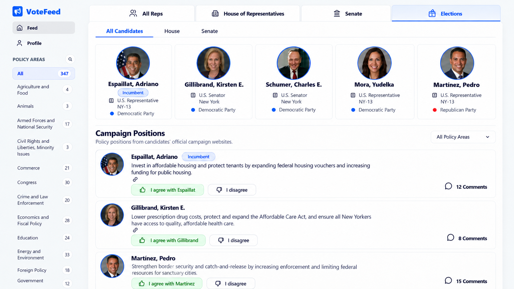

# Desired user behavior

Add an **Elections** tab to VoteFeed so people can read campaign positions from candidates in their matching 2026 regular House and Senate races, filter those positions, explore one candidate at a time, and save agreement or disagreement. This spec defines frontend behavior and acceptance. The local Elections API needed to connect the panel is implemented under [the backend plan](elections-backend.md); this document records the client-facing contract and does not describe production rollout.

## Design authority and ticket scope

The image attached to the October 28, 2026 request is the **absolute visual and UI reference** for this Elections feed. Match its composition, typography, colors, spacing, portraits, borders, controls, and hierarchy. Do not replace it with a new design or the existing legislative card layout. Existing regular-feed behavior guides interactions where applicable; the attached image controls Elections presentation.

**Explicit user decisions:** selecting a candidate card filters the feed in place, with an “All candidates” reset. **Do not add comments, a Comments button, comment counts, or any comments UI for now.** This overrides the comments shown in the reference and excludes comments from the inherited regular-feed behavior.

Tickets read for this spec (their bodies contain no additional acceptance requirements):

- [Add an Elections tab matching the current VoteFeed UI/UX](https://app.notion.com/p/405155d4c85080108e37c0318489d2c5).
- [Allow users to Agree/Disagree with campaign positions](https://app.notion.com/p/405155d4c850806b91b4d8573b8cead2). This is the ticket opened by the second supplied URL's `p=` parameter.
- [Clearly identify incumbent candidates](https://app.notion.com/p/405155d4c8508080829ec413324caebe).
- [Mixed campaign-position feed with House, Senate, and candidate filters](https://app.notion.com/p/405155d4c8508002a2ece0bfa5534725).

Names, photos, party affiliations, example positions, candidate counts, and policy counts in the image are illustrative. Render actual supplied data. In particular, do not assume the pictured Senators are candidates in the user's matching election or infer incumbency from their photos or names.

## Entering and leaving Elections

- Keep the existing sidebar with VoteFeed branding, Feed/Profile navigation, and searchable policy areas. Add **Elections** as the fourth top-level tab beside **All Reps**, **House of Representatives**, and **Senate**, as pictured. Keep these tabs available while Elections is selected, even if current serving-member roster rules would hide a legislative chamber tab.
- Clicking Elections replaces the representative summary and legislative feed with the candidate cards and campaign-position feed. The legislative tabs retain their existing meaning and behavior.
- Default Elections to **All Candidates**, showing positions from all eligible candidates returned for the user's matching races, across parties and both chambers. “All” means these matching races, not a nationwide feed.
- Use the existing signed-in saved-address context and guest address-entry experience. Consume server-resolved election geography; the current representative district must not be reused as proof of the 2026 election district.
- Switching between legislative and election views must not mix their cards, sidebar totals, loading states, responses, or pagination cursors. Retain each view's filters during the current visit; an address/account change clears incompatible candidate selection and old results.
- On app entry, keep the representative feed selected and let it render as soon as its own data is ready. Start the election build independently in the background; election requests and processing must never gate or replace the representative feed. The Elections tab remains available while its data loads, and its saved campaign positions appear as soon as the feed read returns, without waiting for the build to finish. The feed response includes its full-scope policy counts, so do not block position cards on a separate counts request. Keep same-scope saved positions visible during a background refresh and retain them if refresh fails. The mounted Elections panel initializes the build for server-resolved geography; the API deduplicates House work by state and verified district and Senate work by state. If House geography is state-only, no House job is created; state Senate work can still run. Candidate discovery, site search, crawling, and AI extraction run in a separate worker, never in the browser request. When Elections is selected, show a preparation notice and poll the build-status endpoint while work is active; after it finishes, refresh the roster and feed from saved database rows. A completed geography build is reused on later visits.

## Candidate cards and selecting one candidate

- Place **All Candidates / House / Senate** tabs inside the Elections panel above the candidate row, with the reference's blue active text and underline. These filter both the candidate roster and campaign-position feed. Keep this explicit navigation visible; a chamber with no available race or candidates needs an explanatory state.
- Match the reference's equal-width bordered candidate cards, centered circular portraits with blue rings, bold names, compact blue **Incumbent** badge, office sought, state/district, and party name with a colored dot. Use the pictured five-column composition at the reference desktop width; accommodate the actual roster without hiding additional candidates.
- Display **Incumbent** on the candidate card and that candidate's position cards only when the supplied candidacy data explicitly confirms incumbency for the race. Unknown incumbency gets no badge. Office text describes the office sought and does not imply a challenger already holds it.
- Use a consistent initials fallback for missing/broken portraits, preserving card size. Keep party text readable independently of dot color, including other parties and unavailable affiliations.
- Each candidate card is a keyboard-operable selection control. Selecting one keeps the roster visible and limits the feed to that exact candidacy. Add a visible selected border/background consistent with the reference's blue styling, an accessible selected state, and a short label such as “Positions from Adriano Espaillat.”
- Show an **All candidates** reset beside the selected-candidate label. It clears only candidate selection and returns to the current chamber/policy view. Clicking another candidate replaces the selection. Selecting the same candidate again keeps it selected; the reset is the explicit way back.
- Chamber selection clears candidate selection and keeps the chosen policy area. Changing policy area keeps the chosen candidate. Do not remove candidates from the roster merely because they have no positions for the current policy filter.
- Candidates without published positions remain selectable when returned in the roster; explain their availability in the feed instead of making them disappear or inventing content.

## Alignment in the single-candidate view

- When a candidate is selected, expand that selected candidate's summary card to include **Your alignment with [candidate name]**. Keep the other candidates reachable and preserve the All candidates reset. The mixed-candidate view keeps the reference's compact cards without alignment graphs.
- Inherit the current feed's `RepCard.jsx` alignment UI: the same semicircular gauge, needle, percentage, color thresholds, supporting text, and responsive treatment. Adapt its labels and explanation to campaign positions instead of recorded legislative votes. This selected-card extension is an explicit addition to the attached mockup.
- Alignment measures the signed-in user's agreement with that exact candidacy's current published campaign-position versions in the selected policy area, or all policy areas when All is selected. Calculate the percentage as agreements divided by answered positions (agreements plus disagreements), rounded once to a whole percent. Unanswered positions do not enter the denominator. For example, three agreements and one disagreement produce 75% alignment, regardless of how many unanswered positions exist.
- Use the full matching position set, including pages not loaded in the browser. Display the answered-position count and active policy scope so the percentage has context. Old responses to superseded position versions must not silently count toward current alignment or transfer to new versions.
- After a confirmed agree, disagree, or clear action, refresh the selected candidate's alignment. Switching candidate, policy, account, or address must cancel or ignore stale alignment reads so one candidate's score never appears on another candidate's card. Scrolling to another page does not change the score by itself.
- With no answered positions, use the inherited no-data treatment and election-specific guidance such as “Agree or disagree with a campaign position to see your alignment.” Do not present a numeric 0% as an established score. An actual score of 0% after only disagreements remains a valid result. Guests see the same unscored treatment with the existing sign-in invitation.
- Give alignment its own loading/error/retry state without hiding the candidate or feed. Do not display a previous candidate's or policy area's percentage during loading. A failed refresh must not make a successfully saved response look unsaved; explain that alignment could not be updated and allow retry.

## Campaign positions and policy filtering

- Below the candidate cards, retain the reference's divider, **Campaign Positions** heading, and subtitle: “Policy positions from candidates’ official campaign websites.” Put the **All Policy Areas** dropdown at the right of this heading on desktop.
- Use one shared policy selection for this dropdown and the sidebar, including the sidebar's existing policy-name search. Selecting a topic in either place immediately updates the other and filters the same feed. Policy search narrows the list of policy names, not campaign-position text.
- Policy counts describe the complete selected chamber/candidate scope before the policy filter, across all pages. Count position cards, not candidates, votes, or currently loaded rows. The All total includes uncategorized positions. Do not calculate misleading totals from the loaded page.
- Show a single feed containing all matching candidates' positions rather than separate sections per candidate or chamber. Use stable server ordering; never reorder only the loaded page or imply campaign positions have legislative vote dates. The existing storage read order is described under dependencies below.
- Each position is its own reference-shaped rounded white card: small circular candidate portrait at left; bold candidate name and optional incumbent badge; concise position text; compact campaign-source link below the text; and Agree/Disagree controls below. Remove the reference's comments area entirely.
- Keep the source URL and retrieval date available through an accessible compact source control consistent with that link placement. Open the actual campaign source in a new tab with an accessible label. Display prepared position summaries and evidence; do not run the legislative on-entry AI-summary request or invent a Congress.gov summary toggle.
- Use infinite scrolling like the regular feed, with loading-more feedback, retry after a failed continuation, deduplication by position version, and a clear end of results. Changing chamber, candidate, policy, address, or account restarts pagination and ignores superseded requests. Never filter a partial mixed page locally and call it a complete candidate feed.
- Display coverage/availability messages supplied by the backend. FEC registration must not be presented as ballot confirmation or proof of a complete ballot. Provide compact supporting copy when ballot status or coverage is unknown; do not add an invented “ballot confirmed” badge.

## Agree and Disagree

- Signed-in users can agree or disagree with each individual campaign position. Actions affect only that position version, never every position by the candidate or a legislative vote.
- Unanswered controls are neutral. A confirmed agreement gets the reference's green selected treatment and candidate-specific label, such as **I agree with Espaillat**. A confirmed disagreement gets the regular feed's corresponding selected treatment. Use accessible labels and pressed states even when neutral controls show icons only.
- Match the regular feed's response behavior: clicking the selected response clears it; choosing the other response replaces it. Clearing a stance must preserve any existing private data held by the service, without adding an editor or comments UI.
- Show pending feedback and prevent duplicate actions for that position while saving. Retain the last confirmed response on failure and provide a useful retry message. Saved responses reappear after reload and remain consistent when switching between mixed and single-candidate views.
- Guests may read, filter, select candidates, and open source links. Response actions use the existing highlighted guest sign-up/sign-in prompt and do not save a guest answer.
- Election responses and candidate alignment stay separate from legislative responses, legislative alignment scores, and representative-contact/notification flows. Candidate alignment is shown only in the selected-candidate summary card described above. Do not add contact tools or profile changes to this scope.

## Loading, empty, error, and responsive states

- Preserve the shell and selected controls while loading. Keep the representative feed independent from election loading. Keep roster and position loading/error states separate so a position failure does not erase a loaded candidate row. Show saved same-scope positions while refreshing and retain them after a refresh failure; never show old-scope cards under newly selected filters.
- Distinguish: no matching race confirmed by the service; candidate coverage unknown/incomplete; election geography unavailable; candidates present but no published positions; no positions matching the selected topic; and a failed read. Missing/unverified campaign sites, pending processing, and failed processing must not be described as a candidate having no policy views.
- Show available Senate content when House geography cannot be verified, with a specific House message. Retain readable published content if a refresh failed and the service returns last-successful data, with its original source date and a status message.
- Provide retry for failed roster/feed reads. A failed next page preserves already loaded cards. A publication/cursor invalidation offers a restart from the first page instead of merging incompatible pages. Expired authentication follows the existing sign-in handling.
- At narrower widths, preserve the same hierarchy and controls using the app's existing responsive conventions. Allow the candidate row to wrap or scroll within its own area, keep every candidate reachable, and stack position actions without page-level horizontal overflow. Keep policy controls synchronized on mobile too.
- Tabs, candidate selection, policy controls, source links, and response buttons must work by keyboard and touch, have visible focus, and expose loading/selection/errors to assistive technology. Do not communicate party, incumbent status, or saved response by color alone.

## Current frontend and backend dependencies

Updated October 28, 2026:

- **Local API contract:** `server/app.js` mounts `server/src/api/elections.js` at `/elections`. It exposes `POST /roster`, `/feed`, `/policy-counts`, and `/alignment`, plus authenticated `PUT` and `DELETE /responses/:positionVersionId`. `client/src/elections/electionFeedApi.js` adapts these endpoints to the Elections client interface.
- **Geography and roster:** guest read bodies carry an address for server resolution; signed-in reads use the user's saved 2026 geography evidence. The API rejects browser-supplied state, district, or geography IDs. The roster includes candidates without published positions, explicit race incumbency, optional portraits, and coverage/availability. Missouri House geography remains fail-closed while the 2026 Census TIGER products are regenerated; statewide Senate reads remain possible when state data exists.
- **Feed and totals:** chamber, candidacy, and topic filters are applied in the server query. Responses include position-version IDs, source URL/retrieval time, registration and ballot status, coverage, full-scope policy counts, availability, snapshot ID, and cursor. Invalidated cursors request a first-page restart. Never infer ballot confirmation from FEC registration.
- **Responses and alignment:** authenticated response routes bind to the exact current position-version ID and accept only `agree`/`disagree`; clear removes the stance while preserving private comments in storage. The API payload exposes only the public stance. Alignment is scoped to the user, candidacy, current positions, chamber, and policy area. Guests can read and filter but must sign in to save a response or view personal alignment.
- **Local acceptance boundary:** the focused PostgreSQL route test covers guest and signed-in API requests, geography, roster/feed filters, counts, save/change/clear, alignment, and private-comment retention. The browser checked the development fixture flow and exercised the HTTP adapter with controlled API replies. This is local implementation evidence; deployed databases, role grants, complete election data, and production browser acceptance remain open.

The storage read orders the mixed feed by election date, state, office, seat, race, candidate, claim, and version. Preserve the API's stable order; a new chronological or alternating-candidate ranking algorithm is outside this frontend work. Continue to use the fixture adapter only when `DEV` and `VITE_ELECTION_FIXTURES=true`; do not access election tables directly from the browser.

# Implementation steps

## 1. Prepare the design reference and frontend data boundary

Outcome: the implementing developer has the exact visual target and knows which data the frontend needs.

- [x] Save the supplied original image under `specs/assets/elections-feed-reference.png` and embed it above. Keep the explicit no-comments exception beside it.
- [x] Define an Elections frontend data interface and development-only fixture adapter for roster, positions, response state, full-scope counts, coverage, and pagination. Include confirmed/unknown incumbency, missing portraits, and candidates without positions. Keep fixtures out of the live user path; do not infer HTTP paths or payloads from storage helpers.

## 2. Add Elections to the existing feed shell

Outcome: people can switch between legislative feeds and Elections using the reference's top navigation.

- [x] Make the minimum necessary changes around `Feed.jsx`, `RepCard.jsx`, and `FeedLayout.jsx` to host the shared top tabs and a separate Elections panel. Keep legislative roster-tab rules within the legislative view.
- [x] Preserve the guest banner/sign-in prompt and existing account/address context. Keep election data, filters, counts, responses, and cursors separate from legislative state.
- [x] Pass the active panel's policy selection and full-scope counts to the existing sidebar, including cleanup on view/account/address changes.

## 3. Build candidate navigation and single-candidate filtering

Outcome: the reference's candidate row supports All Candidates, House, Senate, and one candidate at a time.

- [x] Add the inner chamber tabs and candidate-card row, matching the supplied desktop design and preserving access to the full roster on smaller screens.
- [x] Render portraits/fallbacks, office sought, geography, party, and explicit incumbent badges. Use candidacy IDs for selection, never names or current-member IDs.
- [x] Add in-place candidate selection, selected styling, the candidate-specific heading/label, and the All candidates reset. Apply the chamber/policy selection rules above.
- [x] Keep roster retrieval independent from policy-filtered positions and render meaningful roster loading/error/empty states.
- [x] Extend only the selected candidate's summary card with the existing feed's alignment gauge UI. Reuse the presentational component from `RepCard.jsx` with election-specific labels, preserving the legislative graph's behavior and appearance. The gauge reads full-scope API or development-fixture alignment.

## 4. Render campaign positions and connect filters/pagination

Outcome: a reference-matching campaign feed supports the combined filter scope and reliable continuation.

- [x] Add dedicated Elections feed/card components and scoped styles for the heading, subtitle, policy dropdown, portraits, position copy, source control, and response placement. Omit all comments elements.
- [x] Connect sidebar and dropdown to one policy state. Display full-scope counts supplied by the active data interface and preserve unknown totals truthfully.
- [x] Build reads from the complete view/account/location/chamber/candidacy/policy scope through the frontend data interface. Reuse request cancellation patterns, replace the first page on a scope change, and deduplicate continuation by position-version ID.
- [x] Add infinite-scroll feedback, continuation retry, cursor restart, coverage notices, and the distinct empty/error states above. Do not call legislative summary-generation or response APIs.

## 5. Build response and alignment states against the frontend data interface

Outcome: response and alignment interactions use exact-version Elections API operations with an isolated development-fixture implementation.

- [x] Define interface operations for authenticated save/change/clear using exact position-version IDs; implement their development-fixture behavior and the local HTTP adapter.
- [x] Render neutral, pending, confirmed agree/disagree, and failed-save states; reconcile only confirmed results and keep selection consistent across filtered views and fixture reloads.
- [x] Reuse the guest prompt behavior for response attempts and existing authentication-expiry handling. Stance clearing preserves service-held private data; local API integration verifies the behavior.
- [x] Drive the selected-candidate graph from full-scope alignment data scoped by user/candidacy/policy. Refresh after confirmed response changes; handle stale reads, no answers, guests, loading, and refresh failure independently of response saving.

## 6. Verify visual fidelity and fixture-backed behavior

Outcome: record visual fidelity and fixture-backed UI acceptance. The local API acceptance in Step 7 is separate; neither alone establishes production acceptance.

- [ ] Compare rendered desktop screenshots at the reference's 1672 × 941 viewport with the original image, then check smaller desktop, tablet, and phone widths. Review typography, card sizing, spacing, portrait rings, tabs, source links, and selected states; exclude comments from comparison intentionally.
- [ ] Check keyboard/touch operation, focus, readable fallback portraits, long names/position text, other parties, and every loading/empty/error state.
- [ ] Run focused client checks for combined filters, stale requests, continuation deduplication/restart, and response selection/change/clear/failure. Run `npm.cmd --prefix client run lint` and `npm.cmd --prefix client run build`.
- [ ] Recheck existing All Reps/House/Senate feed filtering, sidebar counts, stance controls, and comments navigation for regressions. Record fixture-only results separately from real-service results.

## 7. Integrate with the Elections API

The API and HTTP adapter are implemented locally. The checked-in implementation is not deployed, and the remote migration/role state remains unverified.

Outcome: the frontend uses the local service contract, while local API, fixture, mocked-browser, and production acceptance remain distinct.

- [x] Confirm the HTTP contract and record the endpoints: `POST /elections/roster`, `/feed`, `/build-status`, `/policy-counts`, `/alignment`; authenticated `PUT`/`DELETE /elections/responses/:positionVersionId`. Roster/feed/status requests ensure the matching on-demand build job exists and return its state.
- [x] Implement the real network adapter using the local routes, request/response shapes, authentication, and error behavior. Map it to the frontend data interface without querying election tables directly from the browser.
- [x] Connect roster and feed reads, geography and coverage states, server-side filters, full-scope counts, stable pagination, and cursor restart.
- [x] Connect authenticated version-specific save/change/clear and full-scope alignment. Local route integration verifies that clearing preserves private service data and that private comments are not included in the Elections client payload.
- [x] Exercise local guest and signed-in API flows against a disposable PostgreSQL database. Browser coverage exercised fixtures and the HTTP adapter with controlled mocked API replies; no production service acceptance is claimed.
- [x] Connect build-status polling and preparation/partial-build messages to the Elections panel. The separate worker and queue migration are local implementation only; live Development behavior still requires the migration and worker deployment.

# How to check it works

Local Step 7 API integration passed against a disposable PostgreSQL database. The browser checked fixture behavior and the HTTP adapter against controlled mock replies. Production acceptance remains open until migration rollout, role verification, data coverage, and a browser run against the deployed service.

## Fixture-backed UI acceptance (Steps 1–6)

- [ ] With the development fixture adapter explicitly enabled, open Elections through guest and signed-in address flows. Verify the reference composition and no-comments UI; confirm fixtures are not enabled in the live user path.
- [ ] Switch All Candidates → House → Senate. Both fixture roster and feed follow the chamber; incomplete coverage and no-race states remain distinct. Return to legislative tabs and confirm their original behavior.
- [ ] Select one fixture candidate. Only that candidacy's positions appear, the roster stays visible, and selection is clear. Select a policy area, switch candidates, and use All candidates to restore the current chamber/policy scope.
- [ ] In the single-candidate view, verify the fixture alignment gauge's labels, answered count, and policy scope. A controlled fixture with three agreements and one disagreement should show 75% even when some answers are on unloaded pages. The mixed view has no candidate graphs.
- [ ] Pick a policy area using the sidebar and then the dropdown; both controls stay synchronized. Search policy names. Verify fixture counts represent the complete chamber/candidate scope rather than only loaded rows.
- [ ] Scroll through several fixture pages, retry a failed continuation, then rapidly change candidate/policy/chamber while a request is pending. No stale cards, duplicate positions, skipped continuation pages, or mixed cursors appear.
- [ ] Verify fixture incumbent badges only for explicitly confirmed candidacies; unknown incumbency gets none. Broken portraits retain readable names and stable card layout. Example mockup people/counts are never hardcoded.
- [ ] Exercise fixture no-position, no-topic-match, partial-coverage, missing-site, processing-failure, unavailable-House-geography with available Senate data, read-error, expired-auth, invalid-cursor, no-answer, guest, 0% alignment, and alignment-retry states.
- [ ] Compare desktop screenshots at 1672 × 941 and phone layouts with the original. Complete keyboard/touch navigation through tabs, candidates, policy controls, sources, and response buttons. Check focus visibility and page overflow.

## Production-service acceptance (after rollout)

- [ ] Enter through the existing guest address flow and a signed-in saved address. Confirm the delivered API returns the matching candidates and positions, with accurate geography, coverage, and no-race states.
- [ ] Confirm actual source URLs and retrieval dates open/display correctly; FEC registration is never shown as ballot confirmation or complete ballot coverage.
- [ ] Confirm server-side chamber/candidacy/topic filters and full-scope counts cover the complete API result set, not just the loaded page.
- [ ] With controlled service data of three agreements and one disagreement, confirm 75% alignment includes answers on unloaded pages. Verify no-answer states, a valid 0% score, refresh after response changes, and exclusion of superseded versions.
- [ ] As a signed-in user, agree, reload, change to disagree, reload, then clear the selected response. The exact version retains the confirmed state in mixed and candidate views; unrelated positions and legislative alignment remain unchanged. A failed save preserves the last confirmed state and clearing preserves private service data.
- [ ] As a guest, read/filter/select candidates/open campaign sources, then attempt a response. The existing guest sign-in prompt appears and no response is saved.
- [ ] Recheck real missing-position, coverage, geography, failed-read, expired-auth, and invalidated-cursor behavior and recovery. Ensure the delivered API supports Senate content when House geography is unverified.
- [ ] Enter Elections for one verified House district and confirm one district-scoped job plus one shared state Senate job are created, the panel reports progress, the feed appears after completion, and a later visit reuses the completed jobs.
- [ ] With existing campaign positions saved, enter the app and confirm the representative feed renders independently; open Elections during a build and confirm cached positions appear as soon as the feed read returns, without waiting for processing or a separate policy-count request. Confirm same-scope cards remain visible during refresh and after a refresh failure.
- [ ] Recheck existing All Reps/House/Senate feed filtering, sidebar counts, stance controls, and comments navigation for regressions. Record real-service results separately from fixture acceptance.
