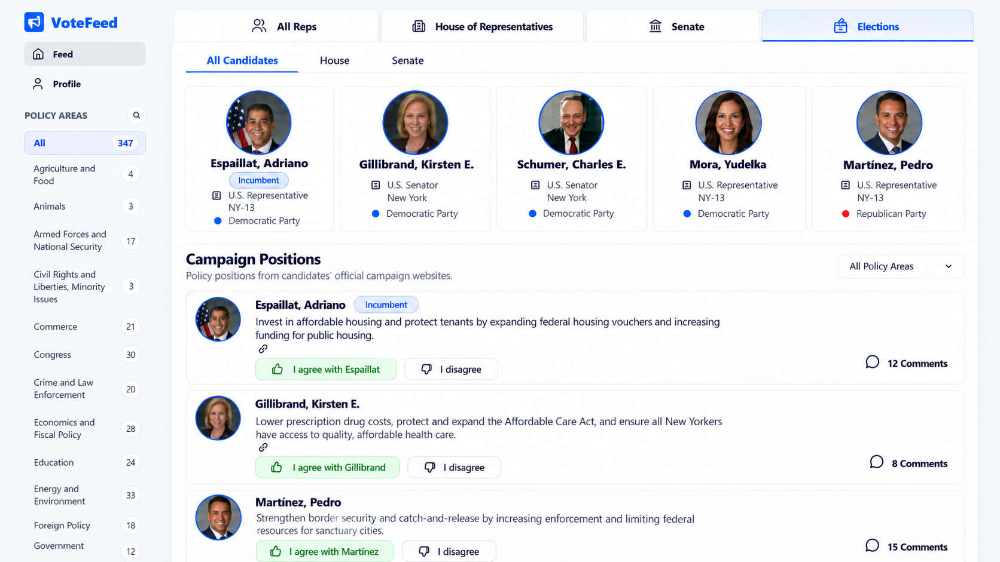

# Desired user behavior

People opening Elections should see the composition, typography, colors, portraits, controls, borders, spacing, and hierarchy of the supplied reference image. The screen should feel like a finished campaign-position feed, with candidate browsing supporting the positions rather than pushing them out of view.

This checklist translates the October 30, 2026 visual critique into ordered correction work. It supplements [elections-frontend.md](elections-frontend.md); that document remains the functional specification. This document does not authorize implementation, data changes, deployment, or changes to candidate eligibility by itself.

## Ground truth and boundaries

- **Visual authority:** `specs/assets/elections-feed-reference.png`, 1672 × 941 pixels. Match this image instead of inventing another design or inheriting the legislative card presentation.
- **Content:** names, photos, positions, parties, and counts in the image are illustrative. Use actual supplied data. Never add candidates or change their eligibility to fill the layout.
- **Comments:** omit comments buttons, counts, panels, and all other comments UI, despite their presence in the image.
- **Responses:** unanswered buttons remain neutral. Compare the image's green agreement treatment with a confirmed agreement state, not an unanswered state.
- **Guest context:** retain the required guest sign-in prompt above the top tabs. Its presence is a valid difference; its dimensions and visual prominence still need refinement.
- **Coverage and build information:** preserve meaningful notices without making development or status information compete with the positions.
- **Alignment:** the selected candidate's summary card expands to contain alignment, as required by the functional spec. Do not use a disconnected full-width panel as a substitute.
- **Data and transport:** preserve server-resolved geography, API ordering, exact candidacy/version identity, request isolation, and the current service contract. Visual corrections must not change eligibility, ballot rules, response persistence, or backend processing.
- **Responsive behavior:** preserve the reference's hierarchy at smaller widths. There is no supplied mobile ground-truth image; mobile acceptance concerns usability, continuity, and accessibility, not unsupported claims of pixel identity.

## Audit baseline and known limitations

The October 30 audit inspected the current local development build in a guest session. The normal fixture returned two candidates. This is not a capture of a deployed service or a signed-in session.

Evidence paths are relative to this document:

- [Desktop audit capture](../output/playwright/audit-01-desktop.png).
- [Reference and implementation together](../output/playwright/audit-reference-comparison.png).
- [Selected-candidate audit capture](../output/playwright/audit-02-selected.png).
- [Mobile audit capture](../output/playwright/audit-03-mobile.png).

Approximate reference measurements and measured implementation positions at a 1672 × 941 viewport:

| Landmark | Reference | Audited implementation | Interpretation |
| --- | --- | --- | --- |
| Outer navigation top | 17px | 107px | About 90px attributable to the guest banner and spacing. |
| Candidate row top | 144px | 241px | About 7px additional displacement after allowing for the guest banner. |
| Campaign Positions title top | 423px | 530px | About 17px additional displacement after allowing for the guest banner. |
| First position card top | 487px | 674px | About 97px additional displacement after allowing for the guest banner. |
| Sidebar All row top | 219px | 250px | Sidebar navigation/section spacing is too loose. |
| Sidebar All row height | 40px | 51px | Row padding and line height need correction. |
| Candidate card height | 244px | 251px | Smaller difference; content-dependent wrapping must be checked. |

These are diagnostic measurements, not universal fixed heights. Do not force long content into clipped boxes to meet them. Normalize auth state, content, viewport, browser density, and scroll position before judging differences.

The previous `design-qa.md` passing verdict was too generous. Treat it as historical evidence, not visual acceptance of the current screen. At the start of this audit every task was unchecked; checked items below now reflect only work completed and verified.

## Current implementation status: November 2, 2026

**Visual review is accepted for the verified layout and fixture states. Signed-in Elections geography, response persistence, and live alignment were also verified against local Dev. The full checklist remains open for the screen-reader speech review.** The final notes, measured landmarks, and evidence paths are in [design-qa.md](../design-qa.md). Fixture-simulated signed-in captures remain distinct from the authenticated Dev session; production acceptance is separate.

Open acceptance work is listed in Section 12 and under “How to check it works.” Role hierarchy, weight, and wrapping have been reviewed at desktop, tablet, and phone; actual 200% browser zoom was verified at desktop, tablet, and phone. The Nov 2 live sample covers House and Senate candidates, real portraits and initials fallbacks across two races, and roster/position crops at 1x and DPR 3; source pixel limits are recorded in the evidence. A final dark capture and direct rendered-text contrast checks pass for the tested guest and fixture-pending states. The simulated signed-in fixture remains visual-only; authenticated geography, persistence, and alignment are verified against Dev in Section 13. Checkboxes below reflect only work completed and verified.

# Implementation steps

## 1. Establish a trustworthy comparison setup — highest priority

Outcome: every correction is evaluated against the original image using equivalent states and representative content.

- [x] Read this checklist and the functional requirements in `elections-frontend.md` before making changes.
- [x] Inspect the current working tree and preserve unrelated edits, including any existing Elections changes. Do not reset or overwrite them.
- [x] Open the reference image at its original dimensions and inspect the whole screen and individual component regions.
- [x] Capture the current implementation before further changes at 1672 × 941, light theme, CSS-pixel scale, and scroll position zero.
- [x] Record browser viewport, screenshot dimensions, device scale, auth state, data source, active chamber, candidate selection, policy selection, and response state with each comparison.
- [x] Verify that captures show fully loaded content. Reject loading screens, stale states, partially populated rosters, and captures taken immediately after a filter change.
- [x] Prepare a clearly labeled, development-only five-candidate visual scenario with representative portraits, varied name lengths, two-line positions, and multiple parties. Do not put it in the live data path.
- [x] Keep a separate normal-data scenario; a five-candidate visual fixture must not conceal a sparse live or normal fixture roster.
- [x] Include one-, two-, three-, five-, and more-than-five-candidate scenarios for layout review.
- [x] Include a separate zero-candidate visual scenario for explicit empty-roster QA; it is not a substitute for real candidate coverage.
- [x] Include portrait success, missing portrait, and broken portrait scenarios.
- [x] Include unanswered, confirmed agreement, confirmed disagreement, pending, failed-response, retry, and clear scenarios in the labeled local fixture; authenticated persistence is separately verified in Section 13.
- [x] Include guest and clearly labeled fixture-simulated signed-in views. Do not remove required guest UI from the product to make a screenshot resemble the reference; the authenticated Dev capture is separately verified in Section 13.
- [x] Label all test-only transformations explicitly. Do not use changes to ballot status or eligibility as product fixes.
- [x] Place the reference and current capture together in a single comparison image at equal scale. Also prepare focused comparisons for tabs, candidate cards, position cards, and sidebar controls.

Acceptance: comparisons can distinguish actual visual drift from different content, auth state, or fixture behavior. No visual conclusion relies on build success alone.

## 2. Restore the screen's vertical hierarchy — highest priority

Likely areas: `client/src/Feed.css`, `FeedLayout.jsx`, `elections/ElectionsPanel.jsx`, and `ElectionsPanel.css`.

Outcome: candidate browsing leads directly into campaign positions, with supporting notices consuming minimal space.

- [x] Measure the outer tabs, panel top padding, inner tabs, roster top/bottom padding, divider, heading, subtitle, dropdown, notices, and first position as one vertical sequence.
- [x] Match the reference's default composition in the labeled simulated signed-in fixture before adding the guest-specific offset; the first position begins at y=488 versus y=487 in the reference. Authenticated behavior is verified separately in Section 13.
- [x] Keep the outer tabs visually joined to the Elections panel, without a floating gap or doubled border.
- [x] Preserve the reference's content left alignment through inner tabs, candidate row, divider, heading, and position cards.
- [x] Remove unnecessary cumulative padding and gaps around the candidate row and campaign heading.
- [x] Keep the Campaign Positions heading, subtitle, and policy dropdown together as one section header.
- [x] Correct the roughly 97px extra heading-to-first-position displacement beyond the guest-banner allowance. Record the revised measurement and explain any remaining state-dependent difference.
- [x] Ensure the opening viewport contains a useful amount of actual position content, rather than primarily shell/status UI.
- [x] Preserve complete long text instead of imposing fixed heights or clipping to obtain a screenshot match.

Acceptance: after accounting for required guest UI, the major section landmarks closely follow the reference. Remaining deviations are documented and supported by user state or content, not unexplained spacing.

## 3. Redesign guest, coverage, and build notices as supporting information — highest priority

Outcome: notices remain truthful, readable, and actionable without interrupting the feed's primary reading path.

- [x] Reduce the guest banner's vertical footprint while retaining its title, concise explanation, and sign-in action.
- [x] Check guest action width so “Sign Up / Sign In” does not wrap awkwardly at common mobile widths.
- [x] Avoid two equally prominent yellow boxes repeating related fixture/coverage context.
- [x] Consolidate related development-only notices where their meaning can remain clear. Keep distinct service problems distinguishable.
- [x] Establish a compact normal informational treatment and a separate treatment for failures requiring action; normal geography, coverage, and build notices use compact status styling, while retryable feed failures use a distinct danger treatment.
- [x] Keep a clear explanation of partial/unknown fixture coverage, unverified House geography, active preparation, and refresh failure; see the combined-notice captures in `design-qa.md`.
- [x] Do not describe missing published positions as a candidate having no policy views.
- [x] Prevent normal status information from separating the campaign heading from the first position by a large block.
- [x] Keep development labels out of the production path; do not hide fixture provenance in development captures.
- [x] Preserve readable status text, status/alert roles, and retry actions for local fixture failures; server-specific announcement behavior remains open.
- [x] Check guest + incomplete coverage + active build and guest + unknown coverage + failed build together; all notices stay concise and the first position remains in the desktop viewport. At phone width 390 x 844 CSS px and actual 200% browser zoom, both combinations retained readable notices without horizontal overflow. The first position begins at y=819 in the active-build state and y=855 in the failed-build state; at that zoom the failed-build card starts just below the initial phone viewport and remains reachable by vertical scroll. See the [active-build phone capture](../output/playwright/elections-mobile-zoom200-partial-running-20261102.png), [failed-build phone capture](../output/playwright/elections-mobile-zoom200-unknown-failed-20261102.png), and [structured results](../output/playwright/elections-mobile-notice-zoom-review-20261102.json).
- [x] Keep saved positions visible during same-scope refresh and after refresh failure; verified in the local refresh-failure scenario, where retry guidance appears above the retained position cards.

Acceptance: notices support the content and do not visually dominate it. Important service limitations remain discoverable and understandable.

## 4. Match typography systematically — high priority

Outcome: the screen shares the reference's text texture, hierarchy, density, and wrapping.

- [x] Identify a closer, legally usable font through visual comparison. Do not assume Arial or an unbundled local Inter face is a faithful match.
- [x] Bundle the Inter 4.1 variable WOFF2 locally for weights 100–900; Edge returned 200 and reported the rendered face loaded.
- [x] Define the system UI fallback and inspect it with the font request blocked; the first-position landmark remained at y=588 in both loaded and fallback views.
- [x] Compare outer-tab labels, inner-tab labels, candidate names, metadata, campaign heading, subtitle, position names, body text, badges, buttons, and sidebar labels individually.
- [x] Tune family, size, weight, line height, and letter spacing together. Do not rely solely on matching CSS font sizes.
- [x] Reduce the overly heavy/wide appearance of candidate names where it differs from the reference.
- [x] Match the Campaign Positions heading's width, weight, and line box.
- [x] Match the reference's supporting-text proportions and muted color without reducing readability.
- [x] Remove excessive letter spacing and visual emphasis from the sidebar section label.
- [x] Make button text, source controls, and metadata use a consistent typographic system.
- [x] Replace the selected-candidate alignment area's oversized uppercase heading with typography consistent with its surrounding card and inherited alignment requirements.
- [x] Test long names, hyphenated names, initials, suffixes, compound surnames, and long party names in the five- and seven-candidate scenarios.
- [x] Verify long or multi-line policy labels using the current taxonomy when such a label is present; do not invent a category name for visual testing.
- [x] Avoid arbitrary name shortening or unreliable surname parsing; only use a supplied response display label for visible button text and retain the complete accessible identity.
- [x] Review typography roles at desktop, tablet, and phone for hierarchy, weight, and wrapping. [Desktop](../output/playwright/elections-typography-roles-desktop-20261030.png), [tablet](../output/playwright/elections-typography-roles-tablet-20261030.png), and [phone](../output/playwright/elections-typography-roles-phone-20261030.png) captures show readable role separation and wrapping.
- [x] Verify literal increased browser zoom at 200%. A disposable Edge profile applied the browser's page-zoom preference; `Page.getLayoutMetrics` reported a 2.0 zoom factor and DPR 2. [Desktop capture](../output/playwright/elections-actual-browser-zoom-200-desktop-20261031.png).
- [x] Compare rendered typography in Chromium and Firefox using the same guest content, 1672 × 941 viewport, 1x device scale, 100% zoom, and loaded Elections Inter font. Campaign heading and position-summary widths differed by at most 0.03px; the long candidate name differed by 0.61px but wrapped to the same two lines; response-label width matched. Chrome and Edge screenshots were pixel-identical. [Chrome](../output/playwright/elections-typography-chrome-20261102.png), [Edge](../output/playwright/elections-typography-edge-20261102.png), and [Firefox](../output/playwright/elections-typography-firefox-20261102.png); measurements and console notes: [cross-browser review](../output/playwright/elections-typography-cross-browser-review-20261102.json). This covers a distinct browser engine on Windows, not another operating system.

Acceptance: focused text comparisons show no major weight, width, wrapping, or hierarchy differences. The chosen font is verifiably rendered, not merely listed in CSS.

## 5. Unify the Elections color system — high priority

Outcome: selections, text, borders, and supporting surfaces belong to the same visual system as the reference.

- [x] Sample or explicitly record the reference's main text, muted text, accent blue, pale selected blue, surface, background, and border colors.
- [x] Establish consistent Elections tokens without changing legislative styling unintentionally.
- [x] Align outer-tab selection, inner-tab selection, sidebar selection, candidate selection, incumbent badges, and source-link color to the same blue family.
- [x] Remove the inconsistent purple/indigo appearance from sidebar selection and selected-candidate summary styling.
- [x] Match the reference's dark navy hierarchy rather than mixing unrelated near-black and gray text treatments.
- [x] Match the pale surface/background balance and subtle cool borders.
- [x] Align party-dot colors with the reference where appropriate, retaining readable party text and support for other/unknown parties.
- [x] Keep green and red response colors tied to confirmed response state.
- [x] Check color contrast for muted metadata, status text, badges, selected controls, and disabled/pending controls in light and dark themes; all reviewed text-color pairs are at least 4.67:1, and pending response buttons retain full opacity.
- [x] Verify dark mode separately so light-reference corrections do not create unreadable dark surfaces or borders.

Acceptance: the screen no longer looks assembled from blue, purple, gray, and yellow component systems with unrelated prominence.

## 6. Finish candidate navigation and roster composition — high priority

Likely areas: `elections/ElectionCandidateNavigation.jsx` and `ElectionCandidateNavigation.css`.

Outcome: five candidates reproduce the reference composition; fewer or more candidates still look deliberate and remain reachable.

- [x] Match the All Candidates / House / Senate labels, horizontal spacing, text weights, baseline, underline thickness, and divider treatment.
- [x] Ensure the active tab's hover/focus treatment does not appear as an unintended permanent filled rectangle.
- [x] Preserve keyboard tab semantics and arrow/Home/End navigation.
- [x] Preserve the fix that clicking the already-selected chamber does not clear the roster or strand it in loading state.
- [x] Match five equal desktop columns, reference card widths, gaps, borders, corner radii, and internal spacing.
- [x] Refine the roughly 251px versus 244px candidate-card height difference using representative content, without clipping long names or metadata.
- [x] Define and document an intentional one-, two-, and three-candidate arrangement. Do not leave an unexplained three-card-sized blank region by accident.
- [x] Keep sparse cards proportionate; do not stretch one card across the full row or create blank placeholder candidates.
- [x] Define handling for more than five candidates and incomplete final rows. Every actual candidate must remain accessible.
- [x] Match the hierarchy and alignment of name, incumbent badge, office, location, party dot, and party name.
- [x] Preserve accurate office-sought wording and display incumbent badges only when explicitly supplied for that candidacy.
- [x] Keep other candidates reachable when one is selected; selection filters positions in place.
- [x] Preserve readable loading/error/empty states without making an incomplete request look like a completed sparse roster; local loading, retryable error/recovery, and explicitly empty-roster states are captured separately.
- [x] Check cards with no published positions; they remain selectable when supplied and receive an honest explanatory feed state.

Acceptance: each roster size looks designed, and the five-candidate scenario closely matches the reference without falsifying data.

## 7. Improve portrait presentation and verification — high priority

Outcome: actual portraits establish the reference's visual character, and fallback states look finished without impersonating real photography.

- [x] Use the actual supplied portrait URL for the correct candidate; do not infer identity from a name or copy mockup politicians into live data. Supabase Dev links the reviewed Shannon Taylor campaign headshot to her ballot-confirmed VA-01 candidacy, and the server projection now passes that explicitly reviewed portrait through.
- [x] Review real photographic portraits in the visual comparison, not only cartoon fixture faces and initials. Equal-scale VA-01/reference review: [real portrait comparison](../output/playwright/elections-va01-real-portrait-comparison-20261030.png).
- [x] Match the reference's approximately 110px roster portrait slot and approximately 76px position portrait slot, including the blue ring.
- [x] Tune crop, object position, ring thickness, and background so faces are centered and not awkwardly cut off. Shared roster and position portraits now use the reviewed 1.25x crop; the live headshot is centered within the blue ring, and the fixture cartoons remain intact.
- [x] Ensure roster and position cards use the same candidate's portrait and consistent fallback initials.
- [x] Design a restrained, readable missing-portrait fallback that preserves dimensions and does not dominate neighboring photos.
- [x] Handle broken images without repeated layout shifts, broken-image icons, or stale portraits after candidate changes.
- [x] Check portrait sharpness at normal and high-density rendering. Reviewed 1x desktop and DPR 3 iPhone captures: [desktop](../output/playwright/elections-va01-real-portrait-desktop-1672x941-20261030.png) and [high-density phone](../output/playwright/elections-va01-real-portrait-highdpi-20261030.png).
- [x] Keep development illustrations clearly labeled as fixtures; do not count them as verification of live portrait coverage.
- [x] Expand real campaign portrait review to a representative sample across multiple candidates and offices. Verify each image against its candidate, compare roster and position crops at 1x and 3x device pixel ratio, and record portrait availability or missing-image fallbacks. The Nov 2 guest sample covers House and Senate candidates in MA-8 and House candidates in CA-38. Stephen Lynch's Congress.gov portrait matches in the roster and position card at 1x and 3x; Edward Markey's Senate portrait was checked in the roster at both densities. Other roster candidates use initials fallbacks. [Full 1x capture](../output/playwright/elections-live-guest-ma-8-senate-20261102.png), [full 3x capture](../output/playwright/elections-live-guest-ma8-dpr3-20261102.png), [Lynch roster crops at 1x and 3x](../output/playwright/elections-live-guest-lynch-roster-1x-20261102.png), [Lynch position crops at 1x and 3x](../output/playwright/elections-live-guest-lynch-position-1x-20261102.png), [Markey roster crops at 1x and 3x](../output/playwright/elections-live-guest-markey-roster-1x-20261102.png), and [CA-38 fallback sample](../output/playwright/elections-live-guest-ca38-fallbacks-20261102.png). Detailed source sizes and coverage are in [portrait review evidence](../output/playwright/elections-live-portrait-review-20261102.json).

Acceptance: photographic and fallback scenarios both look intentional; neither wrong subjects nor illustration-heavy fixtures conceal image-fidelity problems.

## 8. Correct sidebar rhythm and policy controls — medium priority

Outcome: the sidebar is as compact and scannable as the reference, with synchronized policy filtering.

- [x] Match the VoteFeed brand's text proportions, icon proportions, baseline, and spacing.
- [x] Match Feed/Profile row heights, icon sizes, padding, and vertical separation.
- [x] Reduce the gap before Policy Areas so its heading and All row align more closely with the reference.
- [x] Correct the All row from approximately 51px toward the reference's approximately 40px under equivalent content.
- [x] Match policy-row horizontal padding, vertical padding, multiline line height, and spacing between rows.
- [x] Match count-pill diameter/width, padding, border, background, text alignment, and selected color.
- [x] Match the search control's size, position, icon weight, and focus treatment; measured at 32px with a 14px icon and confirmed keyboard-visible focus alongside the no-result state.
- [x] Keep long policy labels readable without crowding count pills or producing inconsistent row alignment.
- [x] Use real taxonomy labels and counts; do not rename categories or copy illustrative totals for visual convenience.
- [x] Review the zero-count fixture categories in the side-by-side comparison; all three remain visible with their actual zero counts and do not replace or rename taxonomy entries.
- [x] Keep sidebar and dropdown selection synchronized through candidate/chamber changes and reset.
- [x] Verify policy search, no-result state, unknown counts, uncategorized content, and mobile policy access; unknown counts are withheld instead of rendered as false zeroes, and the mobile filter returns the null-topic position.

Acceptance: the sidebar's density and emphasis resemble the reference while displaying truthful full-scope counts.

## 9. Refine campaign heading and position cards — high priority

Outcome: positions become the main reading surface, with the reference's compact, coordinated card composition.

- [x] Match heading/subtitle spacing and dropdown alignment relative to the heading block.
- [x] Match dropdown width, height, padding, border, radius, background, and arrow treatment; preserve keyboard/native selection behavior.
- [x] Review selected-option count text against the reference's cleaner default label. Keep complete counts available through the agreed policy controls.
- [x] Match position-card border, radius, outer gap, internal padding, portrait-to-content spacing, and text left alignment.
- [x] Align the candidate name and incumbent badge on a coherent baseline; match badge dimensions and spacing.
- [x] Match summary line height, maximum reading width, and distance from the name.
- [x] Compare equivalent one-line, two-line, and long summaries. Do not label all cards too tall or too short based on different text lengths.
- [x] Preserve the full claim meaning and existing summary content. Do not truncate or rewrite policy claims merely to fit a screenshot.
- [x] Refine the repeated Source details control so source access remains clear without adding unnecessary visual noise to every card.
- [x] Preserve the campaign source URL, retrieval date, unavailable-source state, and ballot qualification where applicable.
- [x] Make expanded source information readable and keyboard/touch accessible without breaking card layout.
- [x] Keep the icon-only source affordance accessible through its name, focus state, and usable hit area.
- [x] Match response-button height, padding, radius, border, icon weight, icon-to-label gap, and spacing between actions; the desktop buttons measure 38px high, with the established 18px horizontal padding, 9px icon gap, and 12px between actions.
- [x] Use a compact candidate-specific response label where supported; avoid excessively wide full-name labels while preserving the complete accessible identity.
- [x] Match the image's green agreement treatment in a confirmed agreement scenario. Verify neutral, disagreement, pending, clear, and failed-save treatments separately in the labeled fixture scenarios.
- [x] Keep the last confirmed response on failure and make retry feedback readable without causing unnecessary card expansion; the failure screenshot retains the confirmed choice and offers Retry inline.
- [x] Rebalance the card's right-hand whitespace after omitting comments. Do not restore comments or add unrelated controls to fill the space; desktop actions sit in the right column while source details stay left, and the card measures 156px high.
- [x] Verify expanded details, long names, and long position text do not overlap actions or escape the card.

Acceptance: portrait, name, badge, claim, source, and response controls read as one coordinated component. The no-comments exception remains intact.

## 10. Integrate selected-candidate alignment into the candidate summary — highest priority

Outcome: selection feels like an extension of candidate browsing rather than a second unrelated dashboard.

- [x] Remove the disconnected full-width purple summary treatment and nested white alignment panel as the default selected-candidate composition.
- [x] Expand the selected candidate's summary card to hold alignment, following the functional spec.
- [x] Keep the other candidates visible or readily reachable through the existing roster area.
- [x] Keep the selected candidate visually identifiable without excessive border/shadow emphasis.
- [x] Keep the candidate-specific positions label and All candidates reset easy to find without adding a large separate section.
- [x] Reuse the inherited alignment gauge, needle, thresholds, percentage, and explanatory treatment in the expanded card; checked in selected desktop and mobile fixture views.
- [x] Remove the oversized, uppercase alignment heading that competes with Campaign Positions.
- [x] Keep the guest/no-answer invitation concise; do not reserve a large blank chart panel when no score exists.
- [x] Show 0% after fixture-simulated answered disagreements distinctly from a no-answer state; authenticated Dev 0% and no-answer states are verified in Section 13.
- [x] Display the answered count and policy scope in the selected card without repeating the context in another large heading.
- [x] Preserve independent alignment error/retry states without hiding the candidate roster or feed; the fixture retry returned to the no-answer state.
- [x] Preserve full-scope alignment, exact candidacy/version semantics, stale-read protection, and refresh after confirmed response changes in the client/service contract; authenticated Dev acceptance is verified in Section 13.
- [x] Recheck the selected desktop viewport: a large alignment panel must not push virtually all campaign positions below the fold.
- [x] Check selected-candidate layout on phone and tablet, including long names and failed alignment reads; both captures retain the selected candidate, alignment error, and zero page overflow.

Acceptance: alignment belongs visually to the selected candidate; the campaign feed remains easy to reach and read.

## 11. Restore mobile content priority — high priority

Outcome: people see campaign positions much earlier, with touch-friendly controls and no page-level overflow.

- [x] Reduce the mobile branding/header footprint while keeping Feed/Profile and account context usable.
- [x] Compact the guest banner and prevent awkward sign-in-label wrapping.
- [x] Preserve the distinction between outer feed tabs and inner Elections chamber tabs without allowing both rows to dominate the screen.
- [x] Evaluate a contained horizontal candidate row to avoid multiple tall roster rows before the first position. Treat this as an implementation direction to validate, not an approved mobile mockup.
- [x] If a scrolling roster is used, provide an obvious continuation cue, keyboard access, touch scrolling, and visibility of the selected candidate.
- [x] Keep all candidates reachable; do not hide additional candidates or rely only on a clipped row.
- [x] Keep the campaign heading, dropdown, and notices compact and clearly ordered.
- [x] Correct the audited 390 × 844 state where the first position begins around 905px, below the initial viewport despite only two candidates.
- [x] In a stable two-candidate guest scenario, make meaningful position content visible in the initial viewport where practical; record its final top position. Do not achieve this by hiding required information or shrinking text excessively.
- [x] Check that a five-plus-candidate roster does not add several screens of navigation before positions.
- [x] Shorten response labels where supported and avoid wrapping a full candidate name into oversized buttons.
- [x] Preserve stacked actions where needed, but tune their padding and spacing so each card is not dominated by controls.
- [x] Check source/details targets, retry buttons, candidate cards, and reset controls for practical touch use; links, response/reset/retry controls provide at least 40px targets and candidate cards remain full-card targets.
- [x] Verify reflow at 320, 375/390, 430, 768, 1024, 1280, and 1672px widths with no page-level horizontal overflow.
- [x] Verify literal increased-text-zoom behavior. An isolated Edge profile used actual 200% browser page zoom, confirmed by `Page.getLayoutMetrics.cssVisualViewport.zoom=2`. At desktop 1672×941, tablet 768×1024 CSS, and phone 390×844 CSS, the page had no horizontal overflow; all five candidates remained reachable in the horizontal roster; the fixture disclaimer, selected summary, source details, and response controls stayed readable. [Desktop](../output/playwright/elections-actual-browser-zoom-200-desktop-20261031.png), [tablet selected](../output/playwright/elections-actual-browser-zoom-200-tablet-selected-20261031.png), [tablet positions](../output/playwright/elections-actual-browser-zoom-200-tablet-position-20261031.png), [phone selected](../output/playwright/elections-actual-browser-zoom-200-phone-selected-20261031.png), and [phone positions](../output/playwright/elections-actual-browser-zoom-200-phone-position-20261031.png).
- [x] Check long summaries, long names, open source details, selected alignment, combined notices, and errors for horizontal overflow across the documented viewport set.

Acceptance: mobile preserves the reference's hierarchy and prioritizes reading positions. No exact mobile image match is claimed without a supplied mobile reference.

## 12. Complete component-detail and accessibility review — medium priority

Outcome: small inconsistencies no longer accumulate into an approximate-looking screen, and controls remain usable.

- [x] Match the reference's closest available library icons for outer navigation, Elections, office metadata, sources, and responses.
- [x] Standardize icon dimensions, stroke weight, baseline, and optical alignment. Do not hand-draw replacement icons.
- [x] Match incumbent badge size, padding, radius, border, and text weight across roster and position cards.
- [x] Match inner-tab underline and outer-tab selected border proportions.
- [x] Match border radii across cards and controls without accidentally rounding every component identically.
- [x] Remove unintended shadows, doubled borders, and surface tints not present in the reference.
- [x] Verify visible hover, keyboard focus, selected, disabled, pending, and error states.
- [x] Ensure focus outlines are not clipped by candidate scrolling containers or rounded panels.
- [x] Ensure selected candidate, party, incumbent status, and saved response are understandable without color alone through pressed states, visible labels, and full accessible names.
- [x] Verify tab order follows a sensible reading order. A full desktop fixture tab pass follows the visible DOM sequence; no CSS `order`, `row-reverse`, or `column-reverse` rules reorder the Elections content.
- [x] Verify accessible names remain complete when visible response labels are shortened. The Nov 2 Edge accessibility-tree review confirmed complete candidate/race/party and response labels at actual 200% zoom: [AX-tree summary](../output/playwright/elections-accessibility-tree-zoom-200-20261102.json).
- [x] Check source-link target size; the audited hit area was only 24 × 24px. Improve practical touch usability without enlarging the visible icon unnecessarily.
- [x] Check contrast and reflow directly; screenshots alone do not establish accessibility compliance.
- [ ] Run a full screen-reader review across outer and inner navigation, roster selection, campaign position and source disclosures, alignment, and response controls. Record spoken names, states, and reading order; accessibility-tree inspection alone does not satisfy this item. Deferred at the user's direction; no screen reader was started.

Acceptance: details are visually consistent and core controls remain keyboard-, touch-, and assistive-technology-friendly.

## 13. Reconcile documentation and run final visual acceptance — blocking completion gate

Outcome: implementation, evidence, and checklist status agree; visual fidelity is not inferred from functional success.

- [x] Capture final desktop screenshots at 1672 × 941 for the representative five-candidate scenario and normal data scenario.
- [x] Capture guest and a clearly labeled simulated signed-in view; disclose that it has no authenticated session or service persistence.
- [x] Capture selected-candidate, confirmed-response, sparse-roster, long-content, and mobile views.
- [x] Compare the final desktop capture and reference together at equal scale, then inspect focused regions at readable resolution. Current-build evidence: [full comparison](../output/playwright/elections-final-comparison-five-20261102.png), [focused position comparison](../output/playwright/elections-final-comparison-position-20261102.png), and [layout measurements](../output/playwright/elections-final-layout-measurements-20261102.json). The first position card is 156px tall in both reference and current render; the guest notice explains the 79px vertical offset.
- [x] Review the five fidelity surfaces explicitly: typography, layout/spacing, colors, imagery, and application copy.
- [x] Record every remaining substantive difference, its priority, correction, and revised screenshot. Repeat after each material correction.
- [x] Do not pass visual QA while major typography, hierarchy, sparse-roster, selected-alignment, or mobile-content issues remain. The final equal-scale comparison and desktop/tablet/phone review show no major visual blockers; signed-in Elections behavior is verified below, and the full assistive-technology review remains open.
- [x] Distinguish intentional exceptions from unresolved defects. A difference is not acceptable merely because it is documented.
- [x] Update `design-qa.md` to supersede its earlier overgenerous verdict with current evidence and a justified result.
- [x] Run `npm.cmd run lint` and `npm.cmd run build` from `client/` after final changes. Record any warning separately from actual failures.
- [x] Run focused existing checks appropriate to modified behavior; add meaningful coverage if the refactor changes request or interaction behavior. Avoid tests that merely duplicate CSS declarations.
- [x] Record browser console errors, failed requests, and their relevance. Resolve product errors before acceptance.
- [x] Reconcile this checklist and the parent frontend spec. Check an item only when its actual acceptance criteria are satisfied; do not mark an entire group complete from one partial check.
- [x] Keep local visual acceptance, fixture interactions, real-service checks, signed-in persistence, and production status distinct in the handoff.
- [x] Provide the final screenshot paths, comparison evidence, checks run, remaining limitations, and next outstanding item. Current-build desktop capture: [five-candidate view](../output/playwright/elections-current-five-desktop-20261102.png).

# How to check it works

Run these user flows after the visual corrections. Check each only after it has been executed against the final implementation; checked flows reflect completed local evidence. The full screen-reader speech review remains open.

- [x] Open the normal feed and verify legislative content renders independently of election preparation; select Elections and inspect the reference composition. A public Williamsburg, VA-01 address loaded the live legislative feed from the local Dev API; Elections remained a clearly labeled development fixture in this run, and its five-candidate preview was compared with the supplied reference at equal 1672 × 941 sizes. [Legislative feed](../output/playwright/legislative-all-reps-va01-20261030.png), [five-candidate comparison](../output/playwright/elections-five-candidate-comparison-after-crop-20261030.png).
- [x] At 1672 × 941, compare a representative five-candidate view with the source image, allowing only the explicit content/state exceptions.
- [x] Check one, two, three, five, and more than five candidates. Each actual candidate remains reachable and sparse results look intentional.
- [x] Select All Candidates → House → Senate → All Candidates. Roster and positions follow chamber selection; repeated active-tab clicks do not strand loading.
- [x] Select a candidate, change policy, switch candidates, and use All candidates. Confirm correct filtering, retained policy scope, and integrated alignment.
- [x] Change policy through the sidebar and dropdown; search policy names. Confirm synchronized selection and truthful full-scope counts.
- [x] Read long positions, open source details, and open campaign links. Confirm readable source date/qualification and no layout breakage. The VA-01 98-character Taylor position stays within its card; the opened source details show the Oct 30, 2026 retrieval date, and the campaign article opens from its source link. This ballot-confirmed candidate has no ballot qualification notice. [Capture](../output/playwright/elections-va01-long-position-source-details-20261030.png).
- [x] As a guest, attempt a response. Confirm sign-in guidance and no persisted answer.
- [x] In a signed-in browser session, confirm `/users/me` returns the saved election-geography evidence pointer and Elections loads the matching House candidates from that server-linked evidence, without changing the existing Profile or Elections UI. Do not infer the 2026 district from legacy fields alone. The authenticated local Dev session returned HTTP 200 with the evidence pointer and rendered two NY-13 House candidates and 10 positions after reload. No location or UI setting was changed. [Identity-free acceptance record](../output/playwright/elections-signedin-authenticated-acceptance-20261102.json).
- [x] As a signed-in user, agree, reload, disagree, reload, and clear. Confirm exact-version persistence and correct neutral/selected treatments. The same exact position version retained Agree and then Disagree across reloads; after Clear and another reload it was neutral. The final Dev response state is empty. [Identity-free acceptance record](../output/playwright/elections-signedin-authenticated-acceptance-20261102.json).
- [x] Check fixture-simulated pending and failed save states; the last confirmed stance remains visible and retry works. Authenticated persistence is separately verified below.
- [x] Check fixture alignment loading, no answers, guest context, 0%, and a 75% example including unloaded positions; alignment error and retry return to the no-answer state.
- [x] Check authenticated live alignment loading and a live 0% response. Delaying the live alignment request showed “Loading your campaign-position alignment…” before it resolved; the saved Disagree response yielded 0% across one answered position. Clearing and reloading returned to the no-answer state. [Identity-free acceptance record](../output/playwright/elections-signedin-authenticated-acceptance-20261102.json).
- [x] Rapidly change chamber/candidate/policy during pending reads. No stale cards, counts, scores, or mixed pagination appear.
- [x] Scroll through continuation and retry a failed next page with fixture data; visible positions remain during the failure.
- [x] Restart an invalidated cursor without losing valid visible content unexpectedly.
- [x] Check loading, empty, no-topic-match, no-position, incomplete-coverage, confirmed-no-race, candidate availability, unavailable-House, missing/broken portrait, and refresh failure states. Reviewed [loading](../output/playwright/elections-scenario-roster-loading.png), [empty roster](../output/playwright/elections-scenario-roster-empty.png), [no matching policy](../output/playwright/elections-scenario-policy-no-results.png), [combined coverage and House notices](../output/playwright/elections-scenario-combined-notices.png), the [confirmed no-race view](../output/playwright/elections-confirmed-no-race-fixture-20261102.png), the [unknown-coverage view](../output/playwright/elections-incomplete-coverage-unknown-fixture-20261102.png), the four [candidate-availability states](../output/playwright/elections-availability-scenarios-20261102.json), [broken portrait](../output/playwright/elections-final-broken-portrait.png), and [refresh failure](../output/playwright/elections-scenario-refresh-failed.png). The selectable no-position state was checked in Section 6.
- [x] Check the expired-auth state in an authenticated session. In the Nov 2 signed-in Playwright session, a controlled 401 with `AUTHENTICATION_REQUIRED` displayed the expired-session message; the interceptor was removed after capture: [expired-auth state](../output/playwright/elections-expired-auth-signedin-20261102.png).
- [x] At phone/tablet widths, inspect initial content visibility, roster reachability, source controls, response wrapping, alignment, and page overflow.
- [x] Repeat those phone/tablet checks with literal increased text zoom. The actual 200% browser-zoom checks at 768×1024 and 390×844 CSS pixels confirmed no page overflow, reachable roster cards, visible selected alignment context, readable source controls, and 40px response targets. See the linked tablet and phone captures above.
- [x] Navigate core controls by keyboard and check visible focus, selected states, accessible names, and sensible reading order.
- [x] Return to All Reps/House/Senate legislative views and verify existing filtering, counts, stance controls, and comments navigation have no regressions. The signed-in Nov 2 view showed All Reps/House/Senate counts 347/276/71; Agriculture and Food remained 4 and filtered to four positions. Agree/Disagree and comment controls remained available. Opening H.R. 3633 comments and returning to the feed worked; no response or comment was written. [Signed-in regression evidence](../output/playwright/elections-signedin-legislative-regression-20261102.json). The separate public VA-01 pass remains documented above.
- [x] Confirm Elections contains no comments UI and no mockup-specific people, fabricated counts, eligibility changes, or production fixture leakage.
- [x] Review final screenshots against the ground truth before declaring visual completion. Lint/build success and working controls are necessary checks, not substitutes for that review.
