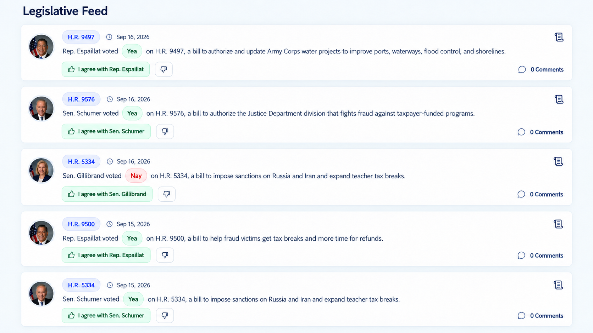

# Legislative Feed: Member Portraits and Combined Senate Votes

## Desired user behavior

The Legislative Feed shows bill-linked voting actions by the user's current House member and current state Senators. Signed-in users use their saved location; guests use their address lookup. The attached October 13, 2026 reference image controls the desktop appearance: circular portraits at the left, bill label and date above the vote sentence, response controls below, a summary toggle at the upper right, and comments at the lower right. Its names, dates, bills, summaries, and selected responses are examples, not data targets.



Reference asset: copied from the user-provided `image (8).png` on October 13, 2026 and visually verified against the conversation attachment. The existing root `FeedV2.png` is an older, different layout and must not be substituted. Rendered implementation comparison remains part of steps 5 and 7.

- Every card shows its member's portrait, or initials when the portrait is missing or fails to load.
- Two Senators with the same recorded position on the same roll call share one card with both portraits. Copy names both members: **Sens. Schumer and Gillibrand voted Yea on H.R. 9576, a bill to ...**.
- Senators with different positions appear in separate cards, each with its own portrait and **Sen.** title. House cards use **Rep.**.
- Matching requires the same chamber, Congress, session, roll call, linked measure, and recorded position. Sharing a bill number or date is insufficient. House and Senate actions never combine. Missing event identity never causes a merge.
- Exact recorded positions determine grouping. Do not silently equate other positions with Yea or Nay. Every recorded action has accurate copy and Agree/Disagree controls that contribute to alignment.
- Cards appear newest first with deterministic ordering for ties. Each page contains complete member groups. Infinite scrolling does not duplicate, skip, or later split matching records across pages.
- Policy-area filtering includes eligible House and Senate cards. Sidebar counts describe displayed cards, so a combined Senate card counts once. Unknown policy areas do not disappear from the unfiltered total.
- Updated October 14, 2026: the top Rep Card's All Reps/House/Senate tabs filter the Legislative Feed. All Reps shows both chambers; House and Senate show only that chamber. Chamber and policy filters combine; changing either restarts pagination. Policy counts describe the selected chamber's complete grouped cards.
- Updated October 15, 2026: hide a chamber's tab when its current roster is confirmed empty. With both chambers, show All Reps/House/Senate. With only one chamber, hide the tab bar without adding a heading; retain each member's Senator/Representative label and automatically scope the feed and alignment to that chamber. One remaining Senator still represents the Senate chamber. With no members, hide the tabs and show an empty-delegation message. Base availability on the roster, never policy-filtered votes. Loading and failed roster reads do not establish a vacancy.
- The summary toggle preserves simplified versus official summaries. Missing or failed summaries produce an understandable state with retry or official fallback; member identity and action remain visible.
- The reference's green labeled agreement button appears only for a saved approval. Disapproval receives its corresponding selected state. Unanswered cards remain neutral.
- The extra Passed/Failed row is omitted from this feed layout to match the reference; recorded vote outcomes remain available in data and appropriate detail views.
- Mobile keeps portraits, vote copy, and controls readable without horizontal overflow. Both portraits on combined cards remain visible; side-by-side circular portraits are the proposed default extension of the single-portrait reference.
- Guests can read cards and open bill details. Response/comment actions retain the sign-in prompt and do not create saved guest responses.
- A vacant House seat does not prevent Senate cards from loading. A Senate vacancy leaves the remaining member visible. Empty results explain whether no delegation, no eligible votes, or no policy matches were found. Loading and retry states do not present incomplete results as a complete feed.
- Bill links and comments retain the exact members and recorded actions represented by the card. Refreshing or directly opening a detail URL must resolve supported context rather than silently substitute the House member.

### Confirmed product decisions

The user confirmed all three decisions on October 13, 2026.

1. **Combined response:** Agree/Disagree applies to both Senators, saving two individual member responses atomically and refreshing alignment once. Unanimous answers select one button; differing or partial existing answers show a mixed state; choosing a stance sets both; clicking an already unanimous selected stance clears both stances while preserving comments.
2. **Comments count:** count public, published bill comments as one shared discussion, without duplicating it for a combined card. Clicking comments opens that bill's shared public discussion while retaining the card's member/event context. Private, draft, or rejected comments must not inflate the count.
3. **Repeated roll calls:** preserve the latest eligible vote per bill, per member, then combine only matching events. Distinct events never combine, even when the bill and recorded position match.

### Scope and dependencies

The current feed reads one House member, and its card labels and response payloads use a shared `rep`. The existing member-vote API can filter by chamber, the roster can resolve Senators, and vote records carry member-vote and event identities. Existing alignment uses individual linked responses. These source contracts support this work; development/Preview data freshness and environment connections need verification during implementation.

This feature covers bill-linked actions supported by the current measure joins. Senate nominations and unlinked procedural events need their own detail design and are outside this scope. Senate ingestion expansion, historical-delegation lookup, production rollout, and Senate notification emails are also outside this scope. Use additive migrations if needed; never reset the existing database with `server/src/db/schema.sql`.

### Feed-card data contract

This is the agreed target shape for one API feed card. It defines data only; the query, grouping, API adapters, and rendering remain subsequent implementation work. Both guest and signed-in paths will return the same card shape. Existing single-member endpoints retain their current field names.

```ts
type LegislativeFeedCard = {
  id: string;
  event: {
    chamber: "House" | "Senate";
    congress: number;
    session: number;
    rollCall: number;
  };
  position: string;
  votedOn: string;
  bill: {
    id: number;
    congress: number;
    type: string;
    number: number;
    title: string | null;
    policyArea: string | null;
    legislationUrl: string | null;
  };
  summary: {
    officialHtml: string | null;
    simplifiedText: string | null;
  };
  members: Array<{
    bioguideId: string;
    memberVoteId: number;
    name: string;
    chamber: "House" | "Senate";
    portrait: string | null;
  }>;
};
```

#### Field meaning and identities

| Field | Meaning and source |
| --- | --- |
| `id` | Stable display-card key, derived from event, linked bill, exact position, and House member identity as described below. Never use array index, page offset, portrait URL, or saved stance as identity. |
| `event` | Full roll-call identity from `chamber`, `congress_number`, `session_number`, and `roll_call_number`. These numbers identify a recorded event, not its chronological position in the feed. |
| `position` | Exact stored `vote` string, such as `Yea`, `Nay`, or `Not Voting`. Shared by all members of a combined card. Alignment classification is separate and must not replace this string. |
| `votedOn` | Event timestamp from `voted_on`, serialized as an ISO 8601 string with timezone. Both members of a combined card refer to the same event date. Human-readable date formatting belongs to the client. |
| `bill` | Verified linked bill: `bill_id`, measure type/number, title, policy area, and legislation URL. `type` uses lowercase codes such as `hr` or `s`; visual labels such as `H.R. 9576` are derived by the client. `congress` identifies the bill's Congress and must agree with the supported event/measure link. |
| `summary` | Official summary HTML from `bills.summary` and cached simplified plain text from `bills.aisummary` when available. Null means content is unavailable or not loaded, not an empty successful summary. Request loading/error/retry state belongs to the client; an official-summary fallback does not remove the member action. Official HTML must follow the application's safe-rendering policy. |
| `members` | One member for a House or separate Senate card; both Senators for a matching Senate card. Bioguide ID identifies the person, while `memberVoteId` identifies that person's exact recorded action. Name/chamber/portrait come from the roster. Null portrait uses initials. |

Define `eventKey` as `JSON.stringify([event.chamber, event.congress, event.session, event.rollCall])`. Define the stable card `id` as:

```js
JSON.stringify([
  "legislative-feed-card-v1",
  event.chamber,
  event.congress,
  event.session,
  event.rollCall,
  bill.id,
  position,
  event.chamber === "House" ? members[0].bioguideId : null,
])
```

JSON tuple serialization preserves field boundaries without ambiguous delimiter concatenation. Matching Senate member records share the card key; their individual `memberVoteId` values remain in `members`. House member identity is included so House actions remain individual. Senate membership does not change the key for the same event/bill/position. Keep `members` in deterministic Bioguide-ID order so portrait/copy order is consistent. Every member's chamber equals the event chamber, and every member-vote link belongs to that member, event, measure, and position.

The shape does not include saved user responses, interaction IDs, request status, pagination, or comment counts. Responses continue to be resolved per member-vote pair; page metadata and public-comment count placement are defined in the later contract item. Do not collapse the two member-vote IDs into one synthetic vote ID.

#### Illustrative combined card

The event, IDs, date, and vote below are synthetic examples, not assertions about a real roll call. `id` is generated by the tuple rule above.

```json
{
  "id": "[\"legislative-feed-card-v1\",\"Senate\",119,2,254,9001,\"Yea\",null]",
  "event": { "chamber": "Senate", "congress": 119, "session": 2, "rollCall": 254 },
  "position": "Yea",
  "votedOn": "2026-09-16T16:00:00Z",
  "bill": {
    "id": 9001,
    "congress": 119,
    "type": "hr",
    "number": 9576,
    "title": "Example bill title",
    "policyArea": null,
    "legislationUrl": null
  },
  "summary": { "officialHtml": null, "simplifiedText": null },
  "members": [
    { "bioguideId": "G000555", "memberVoteId": 102, "name": "Gillibrand, Kirsten", "chamber": "Senate", "portrait": null },
    { "bioguideId": "S000148", "memberVoteId": 101, "name": "Schumer, Charles E.", "chamber": "Senate", "portrait": null }
  ]
}
```

#### Integration notes

- The current `findMemberVotes` result supplies event fields and the individual vote ID, but does not attach per-card roster information. A later adapter/query must provide `members` from the relevant roster rows, using `image_url` for `portrait` as the existing Rep Card adapter does.
- The current bills write/join paths identify measures by type and number and do not establish a persisted bill Congress in those paths. The future query must verify the supported Congress context or add the necessary measure identity support before claiming a multi-Congress contract. Do not invent bill Congress from a display label or silently assume a cross-Congress join is valid.
- The edge-case rules below govern which records can become complete cards and how individual saved answers appear on them.

### Feed-card edge-case rules

These rules define future query, adapter, response-control, and verification behavior. They do not change the current runtime implementation.

#### Incomplete or inconsistent identity

- Require a known House/Senate chamber; positive safe-integer Congress, session, roll call, bill ID, bill number, and member-vote ID; a nonempty Bioguide ID and measure type; a nonempty recorded position; and a valid timestamp. Bill Congress must be established by a verified measure link. A member's chamber and linked vote must agree with the event and bill.
- Never create an identity from `0`, `Unknown`, array position, the user's House member, or the bill number alone. Missing optional portrait, title, summary, policy area, and legislation URL are valid null values and do not invalidate an otherwise complete card. A missing display name uses the known Bioguide ID as a readable fallback; it does not invent a person.
- Exclude invalid source records from cards, grouping, and card counts. Record the reason server-side, and expose an understandable partial-data warning when eligible records were excluded. Do not present an entirely invalid result as a successful ordinary empty feed. Page/warning representation belongs to the next contract item.
- If one Senator's record is invalid, a complete record for the other may appear as an individual card with the partial-data warning. Never infer the absent Senator's position. A vacant seat is an expected roster condition, not an invalid vote record.
- If a later page/read discovers inconsistent dates, bills, or positions for one event, report a data-integrity problem instead of manufacturing a merged card. Complete-group loading must resolve these records before a page is returned.

#### Duplicate records

- Identify an individual recorded action by `(Bioguide ID, chamber, Congress, session, roll call)`. Repeated copies of the same `memberVoteId` are one record, not two portraits or two responses.
- For multiple database rows representing that action with identical measure, position, and event timestamp, retain the greatest positive member-vote ID as the canonical row before latest-vote selection and grouping. Record the duplicate condition for repair. Do not rewrite existing saved vote links automatically.
- If rows for that identity disagree about the measure, position, or event timestamp, exclude the conflicting action and report a partial-data warning. The greatest ID is not evidence that a contradictory position is correct.
- A card contains at most one entry per Bioguide ID. Appending a repeated card ID replaces/reconciles the same card; it does not add another visible card. Return members in deterministic Bioguide-ID order.
- Never silently transfer a stance from a discarded duplicate's vote ID to the canonical vote ID. Such an answer is not an exact answer to the displayed record and requires a separately verified repair if duplicates exist. Protect existing comments and responses during any future repair.

#### Recorded positions versus alignment

- Keep `position` as the exact source string. Group Senators only when these exact strings match; `Yea` and `Aye`, or `Nay` and `No`, may share an alignment meaning but do not share a card under this contract.
- Product decision updated October 14, 2026: Agree/Disagree is available for every valid recorded action, including `Not Voting`, `Present`, and other positions. Exact linked approval counts as alignment; disapproval counts against alignment. Combined responses contribute one answer per Senator under the existing equal-member averaging rule.
- `normalizeMemberPosition` still translates Yea/Aye and Nay/No for independent support/oppose stances. Other positions are never silently translated to support/opposition; exact action agreement does not require that translation.
- Not Voting uses "did not vote"; other positions retain neutral, accurate wording. Missing/blank positions remain invalid feed records under the identity rules above.
- Display the member action once: inside the simplified sentence when available, otherwise in a separate action line during loading, official-summary, or failure modes. Do not repeat it in a response explanation.
- Guests retain the sign-in prompt. Exact member/event links, ownership, batch atomicity, and comment preservation remain required.

#### Saved answers and mixed state

Resolve each member independently using the exact tuple `(bill.id, bioguideId, memberVoteId)`. If multiple exactly linked interactions exist, use the greatest interaction ID, consistent with the current client lookup. Only `approve` and `disapprove` count as displayed answers. Unlinked legacy interactions, answers to different roll calls, and discarded duplicate vote IDs do not select a button for the current card.

| Member answers on a two-Senator card | Displayed response state |
| --- | --- |
| Neither has an exact valid answer | Neutral; neither button selected |
| Both approve | Approve selected; agreement copy names both Senators |
| Both disapprove | Disapprove selected; disagreement copy names both Senators |
| One answered, one unanswered | Partial; neither shared button selected; explain which member has which answer |
| One approves, one disapproves | Mixed; neither shared button selected; explain each member's answer |

- Single-member cards show that member's exact valid answer or neutral state. Mixed/partial states must be visible and accessible; do not use one member's response to imply unanimous agreement.
- Clicking Agree or Disagree from neutral, partial, or mixed state sets that stance for both members in one transaction. Clicking the unanimously selected button clears both stances; choosing the opposite button updates both. Preserve comments when clearing or changing responses.
- Prevent overlapping writes for every member-vote ID represented by the pending batch, including another view/control for the same action. Keep the last confirmed answer state while saving; disable affected response controls. On failure, show an error and preserve/reload confirmed state rather than claiming success for one member.
- After success, reconcile all returned individual interactions and refresh alignment once. Each Senator remains a separate alignment contributor under the existing scoring rule.
- Unknown or malformed saved stances are not treated as approve/disapprove; show no selected state for that member and report invalid response data for investigation. Public discussion counts are independent of the user's saved-answer state.

### Page, counts, and detail-link contract

This target API contract completes step 1. Routes, queries, cursor storage/validation, and BillPage recovery are subsequent implementation work; the current runtime still returns the legacy feed shape.

#### Feed response and request

```ts
type LegislativeFeedResponse = {
  cards: Array<LegislativeFeedCard & {
    publicCommentCount: number | null;
  }>;
  delegation: {
    houseMember: { bioguideId: string; name: string } | null;
    senators: Array<{ bioguideId: string; name: string }>;
  };
  selectedPolicyArea: string | null;
  policyAreas: Array<{ name: string; count: number }>;
  totalPolicyCount: number;
  filteredCardCount: number;
  page: {
    limit: number;
    nextCursor: string | null;
    hasMore: boolean;
    snapshotId: string;
  };
  dataStatus: "complete" | "partial";
  warnings: Array<{
    code: "INVALID_VOTE_RECORDS" | "CONFLICTING_VOTE_RECORDS"
      | "COMMENT_COUNTS_UNAVAILABLE";
    message: string;
  }>;
  emptyReason: "NO_DELEGATION" | "NO_ELIGIBLE_VOTES"
    | "NO_POLICY_MATCHES" | "INVALID_VOTE_DATA" | null;
};
```

- Initial requests accept `limit` (default 5, integer 1–50), optional nonblank `policyArea`, and no cursor. Continuation requests supply the returned opaque `cursor` and the same filter/limit. No row offset is accepted by the new contract. Guest requests also supply validated state/district context; authenticated requests use the saved location. Final route naming is deferred to the API implementation.
- `cards` is the canonical collection. Do not alias grouped cards to legacy `votes` or derive continuation from its length. Existing alignment data can remain an independent response field for authenticated users; it is not part of paging identity.
- `publicCommentCount` is a nonnegative integer counting published, public comments for `bill.id`, using the same visibility rules as the public discussion API. Separate cards for the same bill carry the same count; a combined card displays it once. If unavailable, return null and a warning, and show “Comments” rather than a false zero. Never include private/draft/rejected comments or infer the count from a member's legacy interaction.
- Successful responses include `retry: { mode: "refresh"; message: string } | null`: partial vote data offers a fresh initial read; complete data uses null. Clients replace loaded cards on refresh rather than appending another snapshot. Failed reads return HTTP 503 `{ code: "FEED_READ_FAILED", error: string, retryable: true, retry: { mode: "same-request" } }`; continuation retries retain the same cursor and loaded cards. HTTP 409 restart errors offer `retry.mode: "refresh"`; invalid/forbidden cursor errors are not retryable.
- Warnings contain safe user-facing explanations; server logs hold diagnostic record IDs/details. `dataStatus` is partial whenever records are excluded or comment counts are unavailable. Expected vacant seats and missing optional portraits/summaries alone do not make data partial. A roster/query failure returns a retryable error response, not an invented empty delegation.

#### Complete-group pagination and consistency

- Validate/deduplicate records, apply latest-eligible-vote-per-bill-per-member selection, apply policy scope, and form complete Senate groups before paging. Sort cards by `votedOn` descending, then stable card `id` ascending with explicit consistent string collation. Use the full-precision stored timestamp for ordering; do not round timestamps through a JavaScript Date before constructing continuation boundaries.
- Page a frozen membership/order snapshot of those valid grouped cards. The initial request establishes `snapshotId`; continuation reads the same card identities, canonical member-vote IDs, roster scope, filter, and counts. New votes or roster changes appear on an explicit refresh/new initial request, not halfway through scrolling. Implement snapshot storage or another mechanism that actually preserves this set; a timestamp cutoff alone is insufficient because a later latest-per-bill query could replace earlier cards.
- The opaque cursor binds snapshot identity, authenticated user or guest location scope, sorted delegation IDs, filter, limit, contract version, and last returned ordering tuple. Validate integrity and scope server-side. Do not trust a client-decoded tuple as authorization or a query fragment. Expired snapshots require a fresh initial request; propose a 30-minute fixed snapshot lifetime with explicit expiration handling rather than extending it silently.
- Return `hasMore: true` exactly when another valid card exists in the snapshot. It requires a nonnull `nextCursor`; otherwise return `hasMore: false` and `nextCursor: null`. A final page can contain exactly `limit` cards. An empty continuation is an exhausted page, not a new no-votes condition. Never loop through empty partial pages with `hasMore: true`.
- Invalid/malformed cursors or changed filter/limit return HTTP 400. A cursor for a different authenticated user returns 403. An expired snapshot or changed saved/guest location/delegation/chamber scope returns 409 with a stable restart-required code. The client offers refresh and restarts from page one; it does not append a new snapshot to old cards. Initial query/roster failures return a retryable error without a success-shaped empty response.
- The snapshot fixes card identity, membership, ordering, and counts. Saved responses and public discussion counts may be refreshed independently; these live changes do not alter continuation. A source correction that invalidates the snapshot returns restart-required rather than silently substituting contradictory card data.
- Repeated continuation requests return the same card identities and order. The client reconciles repeated IDs, permits only one load-more request per snapshot at a time, ignores stale responses after filter/location changes, and retains loaded cards on a retryable load-more failure.

#### Policy counts and empty states

- `totalPolicyCount` counts all valid grouped cards in the unfiltered snapshot, including cards with no policy area. `policyAreas` contains nonblank named areas, sorted alphabetically, with counts of cards in each area using those same selection/grouping rules. Their sum can be less than the total because uncategorized cards remain in All.
- `filteredCardCount` counts cards matching `selectedPolicyArea` across the full snapshot, not merely the page. With no filter it equals `totalPolicyCount`. Changing policy starts a new snapshot; sidebar counts remain based on its unfiltered eligible set, not just the selected area.
- `emptyReason` is populated only for an empty initial result: no current members -> `NO_DELEGATION`; no eligible source actions -> `NO_ELIGIBLE_VOTES`; invalid/conflicting records leave no valid eligible cards -> `INVALID_VOTE_DATA`; valid unfiltered cards but no selected-policy matches -> `NO_POLICY_MATCHES`. Apply this precedence so data loss never masquerades as a policy mismatch. Empty continuation pages use null.
- End-of-feed copy is shown when `hasMore` is false and loaded cards exist. Initial empty copy uses `emptyReason`; partial warnings remain visible alongside cards or the empty state. No House member is not itself an empty feed when Senators have eligible actions.

#### Recoverable bill and discussion links

- Retain `/bill/:billType/:billNumber` as the bill page path. Feed-generated links add `congress`, `billId`, `chamber`, `session`, `rollCall`, and repeated `memberVoteId` query parameters (one per card member, in deterministic member order). These fields identify the exact bill/event/member context; navigation state can carry the complete card as a fast display cache but is not the sole source of truth.
- Example combined-card link, using the earlier synthetic fixture: `/bill/hr/9576?congress=119&billId=9001&chamber=Senate&session=2&rollCall=254&memberVoteId=102&memberVoteId=101`. A single-card link includes exactly one member-vote ID.
- On navigation, direct opening, or refresh, resolve the supplied vote IDs server-side and verify that they match the bill path/ID/Congress, chamber, session, and roll call. For two members, verify distinct current represented Senators and the same exact recorded position. Derive names, portraits, positions, and member IDs from verified data rather than trusting URL or cached display text.
- Guest detail links may read public bill/vote context without authentication; response writes still require authentication and validate the user's actual delegation. Reject malformed context with an understandable error; for unavailable/departed members or removed records, keep the bill readable and explain that the saved feed context is unavailable, with context-specific response controls disabled. Never replace a supplied Senator context with the House member or select the bill's latest vote as a substitute.
- A legacy bill URL without event parameters remains a bill-only view. Any current-member fallback must be explicitly presented as separately resolved context, not as the event from the missing feed link. Preserve supported legacy navigation during migration.
- Clicking the comments control uses the same verified context URL with `#public-comments`; BillPage gives the shared discussion that anchor and opens/scrolls to it accessibly. Guest feed comment intent retains the sign-in prompt defined above; direct public detail/discussion reads remain available.
- A grouped BillPage retains both member-vote pairs and offers member selection for individual detail responses and contact drafts. Changing selection does not change the underlying bill or shared public discussion. Return navigation refreshes individual responses/alignment without discarding the feed snapshot or scroll position; an expired snapshot offers an explicit feed refresh.

## Implementation steps

### 1. Confirm the card and interaction contracts

- [x] Record the three product selections above and update dependent tasks.
- [x] Save and embed the actual reference attachment. Verified its portrait placement, bill/date header, inline vote pills, selected-response styling, summary toggle, and comments placement; compare rendered spacing, colors, typography, portrait sizing, and controls during steps 5 and 7.
- [x] Define one card shape containing stable card identity, full event identity, linked bill, recorded position, date, summary data, and a `members` array. Each member retains Bioguide ID, name, chamber, portrait, and its own `memberVoteId`. See [Feed-card data contract](#feed-card-data-contract).
- [x] Define incomplete-identity, duplicate-record, non-comparable-position, and mixed-answer handling. Keep raw recorded positions distinct from any normalized alignment classification. See [Feed-card edge-case rules](#feed-card-edge-case-rules).
- [x] Define the page and policy-count contract, including server-provided continuation and end-of-feed status. Define supported detail-link context for single and combined cards. See [Page, counts, and detail-link contract](#page-counts-and-detail-link-contract).

Likely parts: a new shared delegation-feed service and card contract, plus `client/src/voteInteractions.js`. Define these first so query, UI, and writes agree about what one card means.

### 2. Read and group the delegation before paging

- [x] Resolve current members from saved or guest state/district, preserving at-large district `0` and absent seats. Shared `findCurrentDelegation` resolver is exposed through authenticated `GET /users/me/delegation` (saved location) and guest `GET /reps/delegation?state=Alaska&district=0` (district lookup result). Returns `houseMember: null` and/or `senators: []` for vacancies; roster failures propagate. Feed integration follows in the next items.
- [x] Build a shared query/service for the signed-in and guest feed paths. Select the latest eligible vote per bill, per member, with chamber and Congress included wherever identity requires them. `readDelegationFeedRecords` accepts saved or guest state/district and reads all members together through `findLatestDelegationVotes`, without paging. Selection partitions by member, chamber, Congress, measure type, and number, with deterministic event/ID tie-breakers. Until bills persist Congress, eligibility requires an official Congress.gov measure URL matching Congress/type/number; unverified links are excluded. Real PostgreSQL fixtures cover repeated votes, different chambers/Congresses, exact positions, invalid/unlinked events, vacancies, and saved/guest parity. Card adaptation, exclusion warnings, conflict handling, grouping, and endpoint integration remain later work.
- [x] Attach roster details to each voting member and preserve exact member-vote links. `findLatestDelegationVotes` now attaches `member` (Bioguide ID, exact member-vote ID, roster name/chamber/portrait), `bill`, and `summary` to each individual record. Missing names fall back to Bioguide ID and missing portraits to null. The roster chamber must match the vote chamber. Bill Congress comes from the official URL-verified join, not a number-only assumption; unsupported measure types cannot match. PostgreSQL fixtures verify attachments and reject wrong Congress, URL number prefixes, wrong measure types, and lookalike hosts. Grouping and final card shaping follow in later items.
- [x] Apply eligible-measure and policy filtering, deduplicate member records, then combine complete matching Senate groups before pagination. Shared reads now return unpaged `cards` using the agreed stable ID and member-array contract. `selectDelegationVotes` canonicalizes identical duplicate actions before latest-per-member/measure selection and excludes contradictory actions. `groupDelegationVotes` applies exact policy-area filtering and combines only full matching Senate event/bill/position identities; House actions stay individual. Members sort by Bioguide ID, exact vote links remain intact, and inconsistent group timestamps are excluded. Diagnostics are logged; conflicts/invalid adapted records expose partial-data warnings. Unit and PostgreSQL fixtures verify complete grouping, separate events/positions/chambers, duplicate/conflict handling, and unknown policy areas. Stable feed sorting, pagination, counts, and route/UI integration remain subsequent items.
- [x] Sort newest first with a stable unique tie-breaker; return a validated continuation cursor and `hasMore`. Keep card identity stable across renders, pages, and summary toggles. `readDelegationFeedPage` sorts complete groups by full PostgreSQL microsecond UTC timestamp descending and stable card ID ascending using explicit string comparison. Additive migration `20261014192544_legislative_feed_snapshots.sql` stores server-only 30-minute frozen snapshots, with RLS and browser-role privileges revoked. HMAC-authenticated cursors bind the stored viewer/location/delegation/filter/limit scope and last ordering tuple; retries return the same cards, exact-full final pages terminate correctly, and expiry/location/roster/source corrections require restart. Migration and persistence are verified in isolated PostgreSQL; this migration was applied to `votefeed-dev` (`kddqnmenstoilnzwajnb`) on October 14, 2026. Remote table/index creation, RLS, revoked browser reads, migration history, and a successful local API page were verified. The filename matches the Supabase-assigned migration version; production was not changed. Counts and API/client wiring remain later items.
- [x] Calculate policy-area and total card counts from the same eligibility/grouping rules as the feed. Shared reads group the unfiltered eligible set before exact policy filtering and return alphabetically sorted named `policyAreas`, `totalPolicyCount` including uncategorized cards, and full-snapshot `filteredCardCount`. Combined Senate cards count once; filtered pages retain unfiltered sidebar counts and the existing frozen continuation contract. Unit and PostgreSQL fixtures verify unknown/blank areas, empty/no-match results, grouped counts, filtered pagination, and stable counts across continuation. API/client wiring remains subsequent work.
- [x] Retain legacy single-member routes for compatibility. Added guest `GET /reps/delegation/feed?state=Alaska&district=0` and authenticated `GET /users/me/delegation/feed`; both use `readDelegationFeedPage`. Signed-in scope derives only from `req.user` and its database ID. Strict page-option validation rejects malformed/repeated values, offsets, blank policies, and invalid limits/cursor syntax; the shared resolver validates guest state/district and preserves district `0`. Cursor integrity/scope/expiry errors return structured HTTP 400/403/409 responses. Existing `/users/me/feed`, `/membervotes/:bioguideId`, and `/housevotes/member/:bioguideId` routes retain their behavior. HTTP fixtures and the PostgreSQL-backed delegation suite pass with zero skips. The snapshot migration is now applied to hosted development; frontend integration and detailed empty/retry states remain subsequent work.
- [x] Make failed roster/vote reads distinguishable from valid empty results. Feed routes return HTTP 503 `FEED_READ_FAILED` with `retryable: true` and `retry.mode: "same-request"` for failed reads, without success-shaped empty cards or database details. Valid initial empties return the contracted `emptyReason` with no-delegation/invalid-data/no-votes/no-policy precedence; continuation always returns null. Partial results retain `dataStatus` and warnings across frozen pages and expose `retry.mode: "refresh"`. Same-cursor retry preserves snapshot identities; partial-data refresh replaces the snapshot rather than appending it. HTTP failure fixtures, PostgreSQL empty/conflict fixtures, and continuation-retry tests pass (21 tests, zero skips). Rendering retry controls and client reconciliation remain Step 4 work.

Likely files: `server/src/db/queries/houseVotes.js`, `server/src/db/queries/reps.js`, `server/src/api/users.js`, `server/src/api/houseVotes.js`, `server/app.js`, and a new delegation-feed query/service. Paging complete groups prevents matching Senators from landing on different pages.

### 3. Save responses with accurate member identity

- [x] Replace shared House `rep` assumptions in response lookup and payloads with each card member's identity and exact member-vote ID. `getCardResponseTargets` preserves individual identities for canonical member arrays and legacy records; the legacy query now returns `member_id`. Feed lookup, save payloads, pending controls, and response labels use the represented member and exact event. Missing identity cannot write; grouped writes remain disabled until the atomic batch item. Focused fixtures cover Senate/House identity collisions, earlier events, grouped links, and legacy identity.
- [x] Apply combined-card responses to both Senators and implement mixed/partial saved-answer states. Client response state resolves each exact member/event independently, selects only unanimous valid answers, and explains partial/mixed answers accessibly. Combined actions submit one `PUT /interactions/stances/batch` request with `{bill_id, members: [{rep_bioguide_id, member_vote_id}], stance}`; unanimous toggles send null to clear. The client locks both vote IDs, accepts only a complete `{interactions: [...]}` confirmation, preserves confirmed state on failure, and requests one alignment refresh on success. Focused fixtures cover state transitions, exact links, malformed responses, and reconciliation. The server endpoint is implemented in the following item; hosted operation requires its nullable-stance migration. Canonical-card feed loading/rendering remain Steps 4/5.
- [x] Add an authenticated batch operation that validates every vote link and saves/clears both individual stances in one database transaction. `PUT /interactions/stances/batch` derives the user from authentication, re-reads and locks the saved user location, and validates two distinct current represented Senators, exact vote links, an official Congress-matching bill link and identical event/raw-position/timestamp identity. One transaction locks source context and serializes same-user batches, reuses exact linked interactions, sets the explicit requested stance (null clears), and returns both interactions. Concurrent retries create no duplicate batch writes; failures roll back both updates/inserts. Comments survive clearing and changed stances invalidate contact drafts. Migration `20261014200000_nullable_interaction_stance.sql` permits null stances and is verified locally, but has not been applied to hosted Supabase. PostgreSQL/HTTP fixtures cover authentication, ownership, malformed and invalid links/groups, concurrency, retry, clear/comment preservation, and injected second-write failures. Legacy single-member clearing is implemented in the following item.
- [x] Define stance clearing separately from deleting comments/interactions. Owned `PUT /interactions/:interactionId/stance` accepts an explicit null stance, preserves the interaction and exact member-vote link, rejects event reassignment, and retains legacy and published/draft comment data. Clearing can remove an old answer even if its recorded position is no longer comparable. Feed and BillPage selected-button toggles use this update instead of deleting the interaction; BillPage merges the returned interaction with its existing comment metadata. Explicit interaction/comment deletion remains separate. The existing nullable-stance migration supplies hosted schema support; the fresh-install schema now matches without being executed against any database. PostgreSQL/HTTP tests cover clearing/retry, authorization, unchanged sibling responses, preserved comments, and contact-draft invalidation (13 focused tests, zero skips); client build passes. The nullable-stance migration remains unapplied to hosted Supabase.
- [x] Keep comments/contact-draft consistency when stances change. BillPage preserves comment metadata and unsaved draft text across stance updates, invalidates local contact drafts on stance/context changes, ignores superseded generation responses, and hides contact panels/disables comment and contact controls while saving. Feed disables comments navigation for pending member actions; both response controls retain confirmed state on failure. Server generation verifies the expected stance and conditionally caches only against an unchanged comment version and stance, returning HTTP 409 for stale work rather than saving old text. PostgreSQL fixtures exercise response/comment changes during generation and current-cache reuse alongside batch failure/rollback coverage (13 tests, zero skips). BillPage targeted lint and client build pass; the pre-existing Feed summary-retry lint error remains. Rendered UI verification is still part of Step 7.
- [x] Refresh delegation alignment once after a successful action. Each successful single save/clear or confirmed batch action invokes one shared refresh; `fetchDelegationAlignment` requests `chamber=All Reps` once and receives all three `byChamber` summaries for local Rep Card tab selection. Refresh no longer requires a House representative; entry invalidation follows saved location and policy, with stale responses ignored and refresh failures reported separately from confirmed saves. PostgreSQL fixtures verify that combined saves contribute two distinct Senator comparisons and clearing removes both while retaining member identity; existing equal-member/full-precision averaging tests remain unchanged. The repeatable response suite passes 15 tests with zero skips, including one-request refresh/tab selection and Senate-only scope.
- [x] Keep every recorded position readable and answerable. Updated October 14, 2026: Feed and BillPage allow approval/disapproval on all exact recorded actions and show saved answers normally. Single and batch server writes accept non-voting positions while preserving exact identity and same-event/raw-position validation. Exact approval counts as alignment and disapproval against alignment, including Not Voting/Present/Paired; independent support/oppose classification remains unchanged. Action copy appears once in each summary mode. PostgreSQL/HTTP fixtures cover non-voting single/batch saves and scoring; focused client and scoring fixtures cover all positions and invalid identity rejection.


Likely files: `server/src/api/interactions.js`, `server/src/db/queries/interactions.js`, `server/src/db/queries/memberVoteLinks.js`, `client/src/voteInteractions.js`, and `client/src/Feed.jsx`.

### 4. Connect both feed entry paths

- [x] Update signed-in feed loading, guest address lookup, policy filtering, and load-more to use the shared delegation-card response. Both paths now use the delegation feed endpoints through a shared URL builder and adapter. Canonical cards retain stable IDs, full member arrays, exact vote links, and embedded summaries while display aliases support the current renderer. Guest lookup passes state/district (including district `0`) without requiring a House seat. Filtered and unfiltered scrolling send the server cursor and use `page.hasMore`; this minimum continuation wiring is required because the new routes reject offsets. Eight client identity/response/adapter tests pass with zero skips; targeted lint and production build pass. Dedicated rendering, pagination hardening, summary identity work, detail context, and live UI verification remain later checklist items.
- [x] Replace `votes.length` database-offset assumptions and page-length end detection with the server continuation contract. Initial, filtered, and continuation requests use `limit` plus the opaque server cursor; `page.hasMore` controls the scrolling sentinel. The observer follows cursor changes rather than displayed card count. The adapter rejects missing/inconsistent continuation metadata, invalid limits, and missing snapshot identity rather than treating malformed responses as completed feeds. Fixtures verify full final pages stop, short intermediate pages continue, and empty pages terminate. Client/backend pagination suites pass 11 tests with zero skips; targeted lint, production build, and diff check pass. Location/policy race handling and append deduplication remain the next item.
- [x] Reset pagination when location or policy changes; cancel or ignore stale responses so older requests cannot overwrite the current feed. Deduplicate appended cards by stable identity. One loading effect replaces the feed with a fresh initial snapshot on viewer, saved/guest location, policy, or navigation changes. Abortable request tickets prevent stale success/error/finally handlers from altering current state and serialize page reads. Scope checks prevent old pages from appearing during a change; snapshot/policy/cursor checks prevent cross-snapshot and repeated append commits. Stable-ID reconciliation replaces repeated cards while retaining complete member groups. Sidebar updates no longer overwrite the selected filter from an older feed response; saved profiles refresh on return navigation. Client and pagination fixtures pass 14 tests with zero skips; targeted lint, production build, and diff check pass. Live rapid-switch browser verification remains Step 7.
- [x] Connect the top Rep Card tab selection to the Legislative Feed chamber filter. Feed owns the selected chamber and RepCard reports mouse/keyboard tab changes. Guest and signed-in initial/filter/continuation requests send the chamber. Server validation accepts only All Reps/House/Senate, filters complete groups before paging/counting, and binds chamber to snapshot scope. Tab changes cancel stale reads and restart at page one while preserving the selected policy. Alignment selects the corresponding chamber summary. Roster reuse remains an optional optimization. Client/grouping/API/pagination fixtures pass 26 tests with zero skips; targeted lint, production build, and diff check pass. Live local API verification returned House-only, Senate-only, and combined pages with chamber-specific totals of 276, 71, and 347 for New York district 13. Rendered tab verification remains Step 7.
- [x] Preserve summary fetching/toggling and cache identities, including Congress where necessary to distinguish measures. Keep recorded member action visible in loading, official-summary, and failure modes. Feed summary caches and request locks use Congress/type/number; card toggles retain stable card IDs. Shared requests prevent duplicate generation for multiple event/member cards on the same measure; retries reject empty/error-shaped text and show explicit unavailable states with official fallback. The action appears inside the simplified sentence or in one separate line for loading/official/failure states. Feed requests include Congress; the summary API verifies the official measure URL before serving cached or generated text while retaining legacy URLs. Generated cache writes target the fetched bill ID and unchanged URL/source summary, preventing stale generation from overwriting changed source context. Thirteen focused client/summary/HTTP fixtures pass with zero skips; targeted lint, production build, and diff check pass. No new AI generation was invoked during verification; rendered summary checks remain Step 7.
- [x] Support no House member with a valid state; do not block guest Senate pagination or signed-in alignment refresh merely because a House `rep` is absent. Feed pagination and Rep Card location use the resolved guest/saved location independently of House identity, including during loading and district `0`. Existing alignment refresh has no House-member guard. HTTP/client regression coverage exercises guest and signed-in Senate-only continuation, policy filtering, and intact combined cards with `houseMember: null`; the alignment fixture verifies one refresh supplies all chamber summaries without a House member. Focused suites pass 22 tests with zero skips; targeted lint and production build pass. Rendered vacancy checks remain Step 7.
- [x] Revisit BillPage and implement the user-approved folder layout (October 15, 2026). Preserve the production compact vote/result/counts table below the summary, adding All Reps / House / Senate folders; split Senate actions use individual surname folders, as explicitly confirmed by the user. Entry follows the feed chamber and clicked split action. All Reps is read-only; matching Senate pairs use atomic batch responses, while member folders save exact individual links. Matching Senate pairs share one comment composer and one discussion comment; the call/message step presents separate personalized guides and contact links for both Senators, without an earlier member selector. Repeated standalone vote paragraphs are removed. Unsaved panel drafts survive folder switches. Congress, source card, guest location, and selected folder survive supported URL refreshes; server reads verify the measure and source card and bind totals to the exact roll call. The production H.R. 1 result/counts layout was inspected; fixture desktop/mobile checks cover the adopted folders, split/non-voting identity, read-only All Reps, combined save/clear and unsaved draft preservation. A real local API read of H.R. 1 for New York district 13 returned both chambers with separate results. This is implementation of the explicitly approved layout, not a completed audit of every existing BillPage flow; full real signed-in, contact-generation, comment-publication, and return-navigation acceptance remain Steps 6 and 7.

Likely files: `client/src/LandingPage.jsx`, `client/src/Feed.jsx`, and relevant delegation adapters/hooks. Update every entry and pagination path so only the initial page does not receive Senate support.

### 5. Render cards to match the reference

- [x] Extract a `LegislativeVoteCard` component with a reusable portrait/initials fallback and one or two members. Feed retains request, response, summary, and navigation state. Shared `MemberPortrait` renders each canonical member with an accessible portrait or initials for missing/failed images. The following items record the approved layout and completed rendering checks.
- [x] Match reference portrait placement, bill/date header, inline position pill, sentence, response buttons, summary icon, comments position, borders, background, and spacing. Added scoped card styling with miniature member portraits immediately before the bill pill, party-colored rings (blue Democrat, red Republican, gray other/unavailable), compact spacing, and theme variables. Removed the extra result row to match the reference. Local rendered single/grouped fixtures verified desktop placement, selected approval, partial responses, and official-summary toggling; full live-feed acceptance and responsive/accessibility audits remain later items.
- [x] Generate single/grouped names and appropriate Rep./Sen./Sens. copy consistently, including accurate non-voting wording. Shared feed naming handles comma-form names, suffixes, surname particles, and known compound surnames; accessible names retain full member names. Component fixtures cover House/Senate/grouped titles and Not Voting/Present wording alongside the existing position suite.
- [x] Show saved approve/disapprove and mixed states accurately; omit the extra feed result row. Rendered component fixtures verify selected approve/disapprove, neutral, partial and mixed states, preserved exact vote identity, pending state and no result row. Existing combined-response fixtures verify transitions and complete confirmations; live saved-data acceptance remains Step 7.
- [x] Use semantic buttons/links, accessible names for both members, visible focus, and correctly described response states. Cards are named articles; real buttons expose full member names, pressed states, mixed/partial descriptions and pending status. Comments remains one named button. Fixed the invalid summary focus outline and supplied visible theme-aware focus for every card control. Browser accessibility-tree inspection and Enter-key selection verified member names, selected state and solid focus outline. Spoken screen-reader/live-flow acceptance remains Step 7.
- [x] Add responsive layouts for single and combined cards, long names, wrapped summaries, and enlarged text. The user-approved refinement places 32px desktop miniatures (28px mobile, 26px narrow mobile) directly before the bill pill and removes the separate portrait column; card vertical padding remains 8px. Summary and actions follow naturally below the compact header. Narrow screens and enlarged content can reflow. Browser fixtures checked long names, long summaries, selected/mixed responses, light/dark colors, keyboard focus, and doubled body/action text with no card overflow at observed 306px and 389px widths. Full application acceptance remains Step 7.

Likely files: new `client/src/LegislativeVoteCard.jsx`, optional shared portrait component, `client/src/Feed.jsx`, and `client/src/Feed.css`.

### 6. Preserve detail, comments, and navigation context

- [x] Pass or recover exact single/grouped member-vote context for BillPage. Feed navigation carries the source card, chamber, Congress, and guest location; direct URLs preserve those values. The server validates the measure and source card and returns the exact member/event actions, without substituting a House member for a Senate action. Focused detail/context tests pass; full real signed-in and return-navigation acceptance remains Step 7.
- [x] Implement the approved member-specific detail and contact flow for grouped cards. BillPage uses chamber/member folders; matching Senators share atomic responses and one discussion comment, while split Senate actions have individual folders. Contact guidance is personalized for each Senator with separate contact links, so no earlier member selector is needed. Fixture checks and a real local API read cover the adopted layout; live contact-generation and publication acceptance remain Step 7.
- [x] Return aggregate public, published bill-comment counts using the existing comment system, rather than fetching every comment thread for each feed card. One grouped query counts only the displayed bills with the same visibility predicate as the public discussion API. Counts are returned as card-level `publicCommentCount`; unavailable counts remain null with a partial-data warning. Summaries are fetched once per displayed bill after pagination, keeping repeated summary text out of snapshots. User-facing labels use ?Comments?, including loading, empty, and error states. Comments navigation retains the exact source context and opens, scrolls to, and focuses `#public-comments`, including an explicit empty state. Verified the real signed-in feed and shared discussion in the browser, live API first/continuation pages, and a PostgreSQL visibility fixture. Focused tests, targeted lint, and client production build pass; no migration is required.
- [x] Keep public counts and click destinations consistent between combined and separate cards. Counts are bill-wide and rendered once per card; House and combined Senate cards share the bill discussion. Fixtures verify shared totals, excluded nonpublic comments, zero/one/many/unknown labels, preserved member groups, current continuation counts, and count-query failure without losing cards.
- [x] Refresh saved response state and alignment after returning from BillPage; support direct URLs/refresh with the defined context contract. Interaction data reloads on feed entry, alignment refreshes on entry, and the detail URL preserves Congress, source card, guest location, and selected folder. Full signed-in return-navigation acceptance remains Step 7.

Likely files: `client/src/BillPage.jsx`, `server/src/api/comments.js`, relevant comment queries, and feed response/navigation code.

### 7. Verify behavior and reference fidelity

- [ ] Add focused query/grouping fixtures for matching and split positions, repeated events, duplicate records, incomplete identities, and House/Senate identity collisions.
- [ ] Verify complete-group pagination at boundaries, tie ordering, continuation validation, filtered counts, and no duplicated/skipped cards across pages.
- [ ] Verify grouped response atomicity, retry behavior, invalid-link rejection, mixed state, stance clearing with comment preservation, and unchanged alignment scoring.
- [ ] Run the client production build, targeted lint, and focused new tests. Report pre-existing failures separately. The server's placeholder `npm test` is not meaningful verification; use explicit test-file commands.
- [ ] Verify development/Preview feed data and guest/signed-in flows. Compare rendered desktop with the actual reference and inspect mobile, keyboard navigation, focus, and screen-reader names.

## How to check it works

- [ ] A user with one House member and two Senators sees all three members' eligible actions; every card has the correct portrait or initials.
- [ ] Same-event Yea/Yea and Nay/Nay Senate pairs produce one card with both portraits and names. Yea/Nay produces two cards. Same bill on different roll calls never combines.
- [ ] At least one matching pair falls at a pagination boundary; scrolling and policy filtering retain complete groups, consistent counts, and no duplicate/missing cards.
- [ ] Combined responses apply to both Senators. Failed saves leave no half-saved batch. Existing mixed answers are represented truthfully, comments survive stance clearing, and alignment refreshes once after success.
- [ ] Bill and comments links retain the right member/event context, including grouped cards, browser refresh, and return navigation. Each card displays the bill's public, published comment count once and opens the shared discussion.
- [ ] Guests receive sign-in prompts for interactions; saved-location users load independently. At-large district `0`, vacancies, no policy matches, missing portraits, and API failures have useful states.
- [ ] Simplified/official summary modes, missing-summary states, and non-voting positions preserve truthful action copy.
- [ ] Desktop matches the supplied reference; single and combined mobile cards have no horizontal overflow. Keyboard and accessible labels identify both Senators where relevant.
- [ ] Changing Rep Card tabs filters the feed by chamber and restarts pagination. Existing House behavior remains supported and this feature introduces no Senate notification emails.
